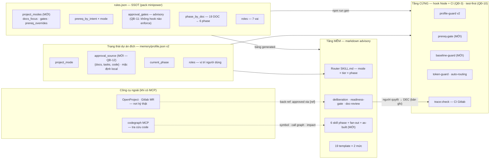
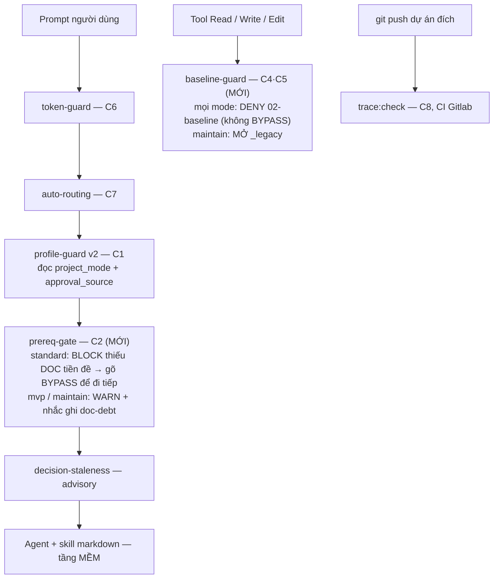
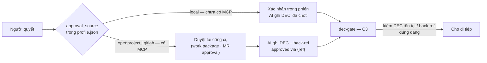

# Minipower — 3 chế độ dự án, điều kiện cứng bằng hook

| | |
|---|---|
| **Ngày** | 2026-08-20 |
| **Trạng thái** | 🟣 **CANCEL** (2026-11-24) — `project_mode` gỡ theo chốt #3 §8.2 (S7 / #13): mức gate thành số khai `rules.json → gate_levels`, một mức cho mọi dự án; profile cũ còn trường vẫn hợp lệ. **Kế thừa giữ nguyên:** «cứng bằng máy, mềm bằng lời» · `prereq-gate` theo module (QĐ-13) · `baseline-guard` · một cấu trúc folder (QĐ-2) · `doc_scope` · `memory/doc-debt.md` · QĐ-11/12/14. Lịch sử bên dưới giữ nguyên văn: ⚪ Todo — định hướng đã chốt (§0), **chưa** chạm code. **§9: Q1–Q8 chốt (2026-08-21)** — sinh QĐ-11 (bỏ `dec-gate`) · QĐ-12 (`approval_source` tách theo loại) · QĐ-13 (`prereq-gate` theo module) · QĐ-14 (fan-out = pipeline theo module). **Q9 đã chốt tại việc #2 (2026-08-21) — không còn câu hỏi mở.** Việc **#1 🟢** · **#2 🟢** · **#3 🟢** — hook đã chạy thật, 316/316 test |
| **Phạm vi** | Toàn `minipower/` — **giữ kiến trúc pipeline hiện tại** (6 phase / 19 DOC / phân tầng / rules-as-data / **một cấu trúc folder duy nhất**), thêm chiều thứ hai **`project_mode`** (3 chế độ) chỉ chi phối *nội dung nào được điền* và *gate nào bật*, và chuyển nguyên tắc cưỡng chế sang **"cứng bằng máy, mềm bằng lời"** |
| **Nối tiếp** | **Huỷ** [ADR-019](../cancel/ADR-019-2026-08-20-minipower-harness-khong-gate.md) (kế thừa QĐ-5 advisory · QĐ-6 `trace:check` · §3 ánh xạ vai→công cụ) · khôi phục một phần tinh thần [ADR-003](../cancel/ADR-003-2026-07-20-minipower-gated-fanout-execution.md) — DEC-cổng trước fan-out trở lại **cho riêng mode `standard`, bằng hook thay vì câu chữ** · khôi phục **back-ref "approved via {ref}"** của [ADR-018](../cancel/ADR-018-2026-08-20-minipower-phe-duyet-openproject-publish-outline.md) làm nền cho QĐ-9 · khôi phục **test-first** ([ADR-014](../todo/ADR-014-2026-07-28-minipower-spine-tong-hop-wrap-not-build.md) P2) cho riêng tầng hook (QĐ-10) · **giữ** ADR-014 (wrap-not-build) · [ADR-008](../todo/ADR-008-2026-07-25-minipower-proposal-suite.md) · [ADR-016](../todo/ADR-016-2026-08-02-minipower-discovery-tom-tat-tai-lieu-lon.md) |
| **Mục đích** | Một bộ minipower phục vụ được 3 tình huống thật: **MVP** (chạy được, tài liệu cơ bản) · **Chuẩn chỉnh** (sản phẩm mới / outsource, tài liệu đầy đủ) · **Maintain legacy** (tài liệu cũ rời rạc, vào code trước) — **không phân mảnh cấu trúc**, và mọi điều kiện cứng còn lại phải là **code kiểm được**, không phải markdown nhờ agent tự giác |
| **Ảnh hưởng** | [AGENTS.md](../../AGENTS.md) §0 + mục gatekeeper (diễn đạt lại theo mode) · [rules.json](../../src/router/hooks/lib/rules.json) (+`project_modes`, `prereq_by_intent`×mode, `approval_gates`×mode) · [minipower/SKILL.md](../../src/router/skills/minipower-router/SKILL.md) (init câu 6–7, bảng mode×tier, trigger `as-built`) · `hooks/lib` + `hooks/bin` (3 hook mới, 2 hook nâng cấp, **test viết trước** — QĐ-10) · 3 skill gate + **[fan-out](../../src/router/docs/parallel-work.md) (viết lại — QĐ-14)** + [parallel-work.md](../../src/router/docs/parallel-work.md) (sửa dòng 7) + [change-control](../../src/analyst/skills/minipower-analyst-cr/SKILL.md) · skill **mới** `as-built` (wrap **codegraph** — QĐ-6) · [templates/](../../src/router/templates/) (nhãn 2 mức) · [project-skeleton](../../src/router/project-skeleton/) (+`assets/archive/`, +`memory/doc-debt.md`) · `install/*` (**bỏ** `permissions.deny` tĩnh) · [COORDINATION.md](../../contracts/README.md) H1–H6 |

---

## §0. Quyết định

| # | Nội dung |
|---|---|
| **QĐ-1** | **Giữ kiến trúc, thêm chiều `project_mode`.** Pipeline 6 phase / 19 DOC / phân tầng micro-light-full / rules-as-data giữ nguyên. Thêm thuộc tính **per-project** `project_mode ∈ {mvp, standard, maintain}` — sống ở `memory/profile.json` (schema **v2**), hỏi ở **câu 6** của init, đổi mode là sự kiện có nghi thức (QĐ-7) |
| **QĐ-2** | **MỘT cấu trúc folder cho cả 3 mode — mode chỉ đổi *nội dung được điền*, không đổi *khung*.** Init luôn copy đủ `docs/` 7 folder + `memory/` 6 folder ở **mọi** mode; folder chưa dùng thì **rỗng có README nêu lý do**, không bị cắt. Lý do: (a) **tương thích ngược** với dự án đã cài bản cũ; (b) `mvp` và `maintain` **rồi sẽ phải bổ sung đủ tài liệu** — cắt folder hôm nay là tạo việc di trú ngày mai; (c) một khung = một exit checklist = một bộ test, không phân mảnh. `project_modes` vì thế khai **`docs_focus`** (DOC nào cần điền ở mode này) chứ **không** khai `skeleton_skip` |
| **QĐ-3** | **"Cứng bằng máy, mềm bằng lời."** Mọi điều kiện CỨNG phải được cưỡng chế bằng **code** (hook Node hoặc CI) đọc `rules.json` + `profile.json`; markdown chỉ mô tả hành vi **advisory** + tri thức. Điều kiện cứng chỉ gồm thứ **máy kiểm được**: tồn tại file DOC, trạng thái DEC, đường dẫn, ID. Phán đoán ngữ nghĩa (5 chiều doc-review, verdict deliberation, "đủ tạm") **vĩnh viễn advisory** — người quyết; quyết định vật chất hoá thành **DEC** để máy kiểm sự tồn tại (C3, §4). **BYPASS** là đường thoát có chủ đích ở mọi block trừ baseline-guard |
| **QĐ-4** | **Bộ hook:** ~~3~~ **2 hook MỚI** (`prereq-gate`, `baseline-guard`) + `profile-guard` v2 (`baseline-guard` thay `token-guard-read`). *(`dec-gate` bị bỏ — QĐ-11.)* **Bỏ `permissions.deny` tĩnh** khỏi `install/*` — dồn toàn bộ cưỡng chế về hook (một SSOT cưỡng chế; hết lệch giữa kênh plugin và kênh settings). Tái dùng hạ tầng sẵn có: `matchIntents` ([lib/rules.js](../../src/router/hooks/lib/rules.js) — hiện chưa ai gọi) |
| **QĐ-5** | **`trace:check` + CI** (kế thừa nguyên vẹn ADR-019 QĐ-6): script Node thuần trong `hooks/`, golden test, chạy trong CI Gitlab dự án đích. **Fail** khi ID trỏ sai / trùng · **warn** khi FR thiếu AC hoặc AC thiếu Test. Mode `mvp`/`maintain` chỉ kiểm ID trong tài liệu **đang có** — không phạt vì tài liệu chưa viết |
| **QĐ-6** | **Mode `maintain` có đường brownfield — skill `as-built` (người trigger, wrap công cụ).** *As-built* = **bản vẽ hoàn công**: tài liệu mô tả hệ thống **đã xây**, ngược chiều tài liệu đặc tả cái **sắp xây**. Skill này **wrap [codegraph](https://github.com/colbymchenry/codegraph)** (tree-sitter → SQLite FTS5, 40+ ngôn ngữ, có sẵn **MCP server** + CLI, chạy local) làm tầng tra cứu cấu trúc code — đúng **wrap-not-build** (ADR-014), và giảm token đúng tinh thần `token-guard`. Codegraph **không thay được** `as-built`: nó trả *cấu trúc* (symbol, call graph, impact), skill trả *tài liệu có ID trace được, có người xác nhận* (business rule, quyết định, runbook). **Optional dependency:** không có codegraph → skill degrade về Read/Grep, không hỏng |
| **QĐ-7** | **Chuyển mode là luồng có nghi thức** qua `change-control`: `mvp → standard` = trả nợ theo sổ **`memory/doc-debt.md`** (backfill BR/UC/SRS từ artifact MVP) + chốt baseline đầu tiên; `maintain → standard` = as-built đủ `docs_focus` rồi chốt baseline. Mọi lần đổi `project_mode` phải kèm DEC — chặn "tự nhận mvp để né gate" (R3) |
| **QĐ-8** | **Huỷ ADR-019.** Khác cốt lõi: ADR-019 bỏ mọi gate + bỏ phân tầng; ADR-020 **giữ cả hai** nhưng tham-số-hoá theo mode, và chuyển phần "cứng" từ câu chữ sang code |
| **QĐ-9** | **Phê duyệt: local trước, MCP sau — cùng một hợp đồng.** Thêm `approval_source ∈ {local, openproject, gitlab}` vào `profile.json` v2 (hỏi ở **câu 7** init, đổi được bất cứ lúc nào). **`local`** (chưa có MCP): người xác nhận trong phiên, AI ghi DEC "đã chốt" → `dec-gate` kiểm DEC. **`external`** (`openproject`/`gitlab`): minipower **không hỏi confirm nữa** — phê duyệt sống ở công cụ; AI ghi DEC kèm **back-ref `approved via {ref}`** (kế thừa ADR-018) → `dec-gate` kiểm **back-ref có mặt và đúng dạng**, không tự phán duyệt/chưa duyệt. **DEC tồn tại ở cả hai chế độ** (bản ghi local + đầu vào `trace:check`); chỉ *nguồn chân lý của chữ ký* dời ra ngoài. Bật MCP = đổi một trường, không phải viết lại skill (§4d) |
| **QĐ-11** | **Bỏ `dec-gate` — chữ ký không còn là điều kiện máy kiểm** *(người chốt 2026-08-21, đóng §9)*. Nguyên tắc: **con người là người ra lệnh**; nếu người yêu cầu làm SRS khi BRD chưa xong thì hệ chỉ **cảnh báo**, người xác nhận là chạy. Hệ quả: (a) **C3 và hook `dec-gate` bị xoá khỏi phạm vi** — cảnh báo "cổng chưa chốt" gộp vào `prereq-gate`; 3 hook mới → **2**; (b) **DEC vẫn ghi** làm bản ghi lịch sử + đầu vào `trace:check`, chỉ **không** còn là điều kiện qua cổng — vì thế **chưa cần** format DEC máy-đọc (`Gate:` / `Approved-via:`), hoãn đến khi bật MCP thật; (c) `approval_gates` trong `rules.json` **giữ** nhưng thành **dữ liệu advisory** cho tầng mềm, không có hook nào enforce; (d) "người OK" hiện thực bằng **`prereq-gate` block + BYPASS** — BYPASS chính là thao tác xác nhận tường minh, không phát minh cơ chế mới. **QĐ-3 thu hẹp:** điều kiện cứng còn lại là C1 · C2 · C4 · C5 · C6 · C7 · C8 |
| **QĐ-12** | **`approval_source` tách theo loại** *(người chốt 2026-08-21, đóng Q3)* — object `{ docs, tasks, code }`, mỗi trường mặc định `local`, đổi sang tên MCP khi có. Cùng khuôn với codegraph (QĐ-6): **local là mặc định chạy được, MCP là nơi đến khi có**. Vì QĐ-11 đã bỏ `dec-gate`, trường này hiện **chỉ chi phối tầng mềm** (skill ghi DEC kèm back-ref ở đâu), không hook nào đọc |
| **QĐ-13** | **`prereq-gate` kiểm tiền đề theo MODULE, không theo dự án** *(người chốt 2026-08-21)*. Prompt nêu module → kiểm DOC tiền đề **trong `docs/03-modules/{id}/`**; không nêu module → kiểm cấp dự án (DOC-03…). Lý do: các module **chạy lệch nhịp là bình thường** — Đặt hàng xong khảo sát trong khi Kho chưa bắt đầu. Kiểm cấp dự án kiểu "có ≥1 file là đủ" khiến cảnh báo **tắt vĩnh viễn từ module thứ hai** ⇒ C2 thành trang trí (đúng thứ R8 cấm). **Hệ quả schema — sửa lúc triển khai (2026-08-21, việc #1):** chiều scope gắn vào **DOC**, ~~không phải vào mỗi entry `prereq_by_intent`~~. `rules.json` thêm bảng **`doc_scope`** (`04·05·06·07·16·19` = `module`, còn lại = `project` — khớp cây `docs/` §2b). Lý do bỏ phương án scope-per-intent: `design-architecture` đòi DOC-03 (dự án) **+** DOC-06 (module) **+** DOC-13 (dự án); một trường scope cho cả entry buộc phải chọn một ⇒ **sai một nửa**. Gắn vào DOC diễn đạt đúng cả hai, và là sự thật rút từ layout thư mục chứ không phải quy ước mới. `prereq-gate` vẫn cần nhận diện module id từ prompt (**Q9**). Người vẫn quyết cuối — cảnh báo xong, gõ BYPASS là chạy (QĐ-11d) |
| **QĐ-14** | **Fan-out là PIPELINE theo module, không phải barrier** *(người chốt 2026-08-21)*. [fan-out](../../src/router/docs/parallel-work.md) hiện mô hình hoá `A,B,C → tổng hợp → cổng kế` — **mọi module phải xong mới đi tiếp**. Sai với thực tế: BA1 xong module A thì **SA làm SRS cho A ngay** trong khi BA2 còn đang khảo sát B; SRS module A xong thì **DEV vào code A** trước. Mỗi module chạy **chuỗi riêng theo nhịp riêng**; **con người** quyết từng module đã đủ thông tin để chảy tiếp chưa. **Tổng hợp** (trace-matrix, hợp nhất BRD đầy đủ) tách thành **bước riêng do lead làm khi muốn**, không phải điều kiện chặn. Đây chính là mô hình [parallel-work.md](../../src/router/docs/parallel-work.md) đã mô tả sẵn (§"SA không cần chờ BA xong toàn bộ", §"Mức tối thiểu để dev bắt đầu") — fan-out phải **thôi mâu thuẫn** với nó |
| **QĐ-10** | **Test trước, hook sau — không ngoại lệ.** Mọi thay đổi ở `hooks/lib` + `hooks/bin` phải: (1) viết test **đỏ** mô tả hành vi đúng cho **cả 3 mode** trước; (2) mới viết/sửa hook cho xanh; (3) `npm run gen && npm test && npm run gen:check` cả ba xanh. Hook là tầng duy nhất **chặn được việc của người dùng** — sai một nhánh là chặn oan hoặc thủng gate, nên nó chịu kỷ luật cao nhất repo (khôi phục *test-first* của ADR-014 P2 cho riêng tầng này) |

---

## §1. Ba chế độ — nhìn một bảng

| | **`mvp`** | **`standard`** | **`maintain`** |
|---|---|---|---|
| Tình huống | Chỉ cần chạy được, tài liệu cơ bản | Sản phẩm mới / outsource; hoặc MVP "lên đời" | Sản phẩm chạy nhiều năm, tài liệu cũ rời rạc |
| Điểm vào | Discovery **rút gọn** (DOC-03 lõi) | Discovery đầy đủ (như hiện tại) | **`as-built`** — người trigger, wrap codegraph (QĐ-6) |
| **Cấu trúc folder** | **Đủ 7 folder `docs/` + 6 folder `memory/`** | **Y hệt** | **Y hệt** |
| `docs_focus` — DOC cần điền | 01 (lõi) · **03** · 06 (mục 3 FR) · 07 · 09 · 17 (rút) | Đủ 19 DOC | 04 (rule khai quật) · 08 · 09 · 10 · 11 · 12 · 17 · 18 |
| DOC còn lại | Folder **có sẵn, rỗng** — nợ ghi `doc-debt.md` | — | Folder **có sẵn, rỗng** — điền dần theo vùng chạm |
| Baseline | Chưa chốt (`02-baseline/` rỗng) | `docs/02-baseline/vX.Y/` | Chưa chốt → chốt khi as-built đủ (QĐ-7) |
| Tài liệu cũ / rời rạc | — | — | **`assets/archive/`** — nguồn tham chiếu, không phải artifact |
| Gate cứng (hook) | prereq **warn** | prereq **block + BYPASS** | prereq **warn** (bộ riêng) · `_legacy` mở |
| Gate mềm (markdown) | doc-review rút chiều · deliberation gọi khi cần | Đủ 5 chiều, ≥3 góc nhìn | doc-review "vùng chạm" · Blocker = chặn merge |
| **Nhịp module** (QĐ-14) | **Mỗi module một nhịp riêng** — người cho phép từng module chảy tiếp | **Y hệt** — khác ở chỗ `prereq-gate` chặn (BYPASS mở) thay vì chỉ nhắc | **Y hệt** — nhịp đi theo CR / vùng chạm |
| Lối ra | → `standard` qua backfill (QĐ-7) | Bàn giao / vận hành | → `standard` khi as-built đủ |

**ID ổn định (`{MOD}-FR-`, `DEC-`, `ADR-`) dùng từ ngày đầu ở CẢ 3 mode** — rẻ lúc viết, là thứ khiến bước lên `standard` khả thi và `trace:check` có cái để kiểm.

### 1a. Mỗi module một nhịp — **người kiểm soát, người cho phép**

Bảng trên nhìn theo **mode**; nhưng công việc thật chạy theo **module**, và các module **lệch nhịp nhau là bình thường** — đó là trạng thái đúng, không phải lỗi cần sửa.

| | |
|---|---|
| **Không có barrier** | Không phải "chốt xong toàn bộ mới được làm bước sau". `ORD` xong khảo sát → SA làm SRS cho `ORD` **ngay**, trong khi BA còn đang khảo sát `INV`. SRS `ORD` xong → DEV vào code `ORD` trước |
| **Người là người cho phép** | Máy **không** tự quyết module nào đủ điều kiện chảy tiếp. Nó chỉ **nhắc** khi thấy thiếu tài liệu đầu vào của đúng module đó (C2 + QĐ-13). Quyết định "đủ rồi, làm đi" là của người — ở `standard` thể hiện bằng **BYPASS**, ở `mvp`/`maintain` là cứ tiếp tục sau khi đọc lời nhắc |
| **Không có agent tự bàn giao** | Không có chuyện AI thấy `ORD` xong rồi tự khởi động SA-agent. Mỗi bước là **một lệnh của người**. Điều phối giữa các module đi qua **ID ổn định** + memory theo chủ đề, không qua "agent gọi agent" |
| **Tổng hợp là một bước riêng** | Hợp nhất BRD đầy đủ, cập nhật `trace-matrix` — **lead làm khi muốn**, không phải điều kiện chặn module nào |

Nói gọn: **AI đi song song theo module, con người mở đường từng nhánh.** Đây là §0 (`AI = trợ lý · Người quyết cuối`) áp vào chiều module, không phải ngoại lệ của nó.

---

## §2. Sơ đồ 1 — Cấu trúc folder

### 2a. Pack `minipower/` (chỉ vẽ phần MỚI / SỬA)

```
minipower/
├── SKILL.md                          SỬA  init câu 6 (mode) + câu 7 (approval_source)
│                                          · bảng mode × tier · trigger as-built
├── hooks/
│   ├── hooks.json                    (generated) 5 hook UserPromptSubmit + 1 PreToolUse
│   ├── test/                         ⚠ VIẾT TRƯỚC (QĐ-10) — mọi hành vi × 3 mode
│   │   ├── prereq-gate.test.js       MỚI  đỏ trước, hook sau
│   │   ├── baseline-guard.test.js    MỚI
│   │   ├── project-mode.test.js      MỚI  fail-open khi thiếu profile.json (R2)
│   │   └── rules.test.js · bin.test.js · plugin-hooks.test.js   SỬA  per-mode (R1)
│   ├── bin/
│   │   ├── prereq-gate.js            MỚI  shim UserPromptSubmit
│   │   └── baseline-guard.js         MỚI  shim PreToolUse Read|Write|Edit
│   └── lib/
│       ├── rules.json                SỬA  + project_modes (docs_focus, KHÔNG skeleton_skip)
│       ├── project-mode.js           MỚI  đọc project_mode + approval_source (dùng chung)
│       ├── prereq-gate.js            MỚI  tái dùng matchIntents (rules.js)
│       ├── baseline-guard.js         MỚI  thay token-guard-read + permissions.deny tĩnh
│       ├── profile-guard.js          SỬA  schema v2 (+ project_mode, + approval_source{docs,tasks,code})
│       └── trace-check.js            MỚI  QĐ-5
├── skills/
│   ├── as-built/SKILL.md             MỚI  người trigger · wrap codegraph (MCP|CLI)
│   │                                      · degrade Read/Grep khi không có
│   ├── readiness-gate/ · doc-review/ · deliberation/   SỬA  hành vi per-mode
│   ├── fan-out/ · change-control/    SỬA  biến thể mode + luồng chuyển mode (QĐ-7)
│   └── ...6 skill phase              GIỮ  (discovery thêm nhánh trỏ as-built)
├── templates/                        SỬA  nhãn 2 mức「lõi ▸ full」DOC-06·08·13·15·16·17
├── docs-skeleton/                    GIỮ NGUYÊN — một cây, copy ĐỦ ở mọi mode (QĐ-2)
├── project-skeleton/                 SỬA  + assets/archive/ · + memory/doc-debt.md
└── install/{claude,cursor,opencode}/ SỬA  BỎ permissions.deny tĩnh (dồn về baseline-guard)
```

### 2b. Dự án đích — **một cây duy nhất cho cả 3 mode** (QĐ-2, QĐ-4 của người dùng)

Khung giống hệt nhau; **mode chỉ đổi cột "ai điền gì trước"**. Không mode nào bị cắt folder.

```
{project}/                                    ┌──────────── ĐIỀN Ở MODE ────────────┐
├── AGENTS.md · CLAUDE.md · README.md · FAQ.md│  mvp    standard   maintain          │
├── memory/                                   │                                      │
│   ├── profile.json   v2: project_mode + approval_source (QĐ-1, QĐ-9)              │
│   ├── memory.md                             │   ●        ●          ●             │
│   ├── doc-debt.md          MỚI — sổ nợ tài liệu, điều kiện vào luồng lên standard  │
│   └── {6 folder chủ đề}/   discovery · requirements · architecture ·               │
│                            planning · delivery · change-control   (GIỮ — §3c)      │
├── assets/                                   │                                      │
│   ├── public/ · internal/                   │                                      │
│   └── archive/            MỚI — tài liệu cũ, rời rạc, không rõ còn đúng            │
│                           (mode maintain đổ vào đây; nguồn tham chiếu,             │
│                            KHÔNG phải artifact — as-built distill ra docs/)        │
├── brainstorm/                               │                                      │
└── docs/                    ← 7 folder ĐỦ Ở MỌI MODE, folder chưa dùng thì rỗng     │
    ├── 00-governance/       DOC-15 · 18 · doc-versioning · baseline-history         │
    ├── 01-project/          DOC-01 · 02 · 03        │  01,03    tất cả    khi cần   │
    ├── 02-baseline/vX.Y/    READ-ONLY — hook deny mọi mode; rỗng đến khi chốt       │
    ├── 03-modules/{mod}/    DOC-04 · 05 · 06 · 07 · 16 │ 06,07  tất cả  04 + vùng chạm│
    ├── 04-platform/         DOC-08…14 · 17 · 09-adr/  │ 09,17  tất cả  08,10,11,12,17│
    ├── 05-traceability/     trace-matrix · doc-registry · overview                  │
    └── 06-changes/                                                                  │
        ├── CR-xxx/          CR                        │  —      sau BL   đơn vị chính│
        └── incident/        MỚI — chỗ đứng chính thức của TPL-incident · postmortem │
```

**Hệ quả có chủ đích:** khi `mvp` hoặc `maintain` lên `standard`, **không có bước di trú cấu trúc** — chỉ điền tiếp vào folder đã có và chốt baseline. Đó là lý do QĐ-2 chọn không cắt.

---

## §3. Sơ đồ 2 — Thành phần × giai đoạn dự án × vị trí

### 3a. Kiến trúc thành phần: một SSOT, hai tầng, một trạng thái



Chốt của kiến trúc **sau QĐ-11**: skill mềm đưa người đến quyết định; quyết định vật chất hoá thành **DEC làm bản ghi + đầu vào `trace:check`** — **không** còn hook nào chặn trên chữ ký. Tầng cứng chỉ giữ thứ máy kiểm được mà không cần phán đoán: profile, tồn tại DOC tiền đề, đường dẫn baseline/legacy, token, phase, ID trace. Hai mũi tên **đứt** là phần tuỳ chọn: có MCP thì chữ ký sống ở công cụ ngoài (QĐ-9, QĐ-12) và tra cứu code đến từ codegraph (QĐ-6); **không có thì hệ vẫn chạy đủ**.

### 3b. Giai đoạn (phase) × chế độ — *folder luôn có; đây là thứ tự ưu tiên điền*

| Phase | `standard` | `mvp` | `maintain` |
|---|---|---|---|
| discovery | ✅ Full (deliberation + verdict) | 🔽 DOC-03 lõi + DOC-01 rút | 🔍 `as-built` khảo sát → điền ngược DOC-01/03 khi cần |
| requirements | ✅ BR → UC → Prototype → SRS → AC | 🔽 FR catalog + AC | 🔍 vùng chạm — DOC-04 khai quật, FR/AC cho thay đổi mới |
| architecture | ✅ SAD đủ 4+1 view | 🔽 ADR + ERD tối thiểu | 🔍 as-built (08/10/11/12) + ADR cho quyết định mới |
| planning | ✅ WBS + SPMP | 🔽 milestone | ➖ theo CR |
| delivery | ✅ | ✅ DOC-17 rút | ✅ **runbook = giá trị cao nhất** |
| change-control | ✅ sau baseline | 🔽 chưa baseline — đổi tự do + ghi `doc-debt.md` | ✅ **CR = đơn vị công việc chính** |

### 3c. `memory/` có cần cấu trúc lại không? — **Không** *(trả lời câu hỏi #2, đóng Q2 cũ)*

Sáu folder `memory/` **không phải trình tự, mà là chủ đề** — chính `memory.md` gọi chúng là "Memory theo chủ đề". Làm song song **không** đòi phẳng hoá; nó đòi **một-owner-một-vùng-ghi**, và folder theo chủ đề cho đúng điều đó: BA ghi `requirements/`, SA ghi `architecture/` cùng lúc, không tranh file. Phẳng hoá thành một sổ chung sẽ **tăng** xung đột ghi khi fan-out — đi ngược [parallel-work.md](../../src/router/docs/parallel-work.md).

Vậy giữ nguyên 6 folder, chỉ thêm **hai thứ**, đều ở cấp gốc `memory/` vì chúng **cắt ngang mọi phase**:

| Thêm | Vì sao ở cấp gốc |
|---|---|
| `memory/doc-debt.md` | Nợ tài liệu của `mvp`/`maintain` không thuộc phase nào — nó là *bản đồ đường lên `standard`* (QĐ-7) |
| `trace:check` / `decision-staleness` **quét toàn bộ** `memory/*/decision-log.md` *(trước QĐ-11 là việc của `dec-gate`)* | Không tạo sổ DEC phẳng thứ hai — đó sẽ là bản sao và sẽ drift ([ADR-001](../done/ADR-001-2026-07-17-danh-gia-minipower-va-chien-luoc-phat-trien.md)). Máy quét 6 file rẻ hơn người đồng bộ 2 nguồn |

### 3d. Vị trí (7 vai) × chế độ — mọi vai dùng được mọi mode, khác trọng tâm

| | BA | PM | SA | DEV | QC | DevOps | Support |
|---|---|---|---|---|---|---|---|
| `mvp` | ● FR/AC gọn | ○ milestone | ○ ADR | **●** code sớm | ○ AC-as-test | ○ deploy | — |
| `standard` | **●** chủ lực | **●** chủ lực | **●** chủ lực | ● theo cổng | ● per-FR | ● | ○ |
| `maintain` | ○ khai quật rule | ○ CR | ● as-built | **●** chủ lực | **●** regression | **●** runbook | **●** incident |

---

## §4. Sơ đồ 3 — Điều kiện cứng → hook (QĐ-3, QĐ-4, QĐ-10)

### 4a. Bảng điều kiện cứng — mỗi dòng là CODE có test, không phải câu chữ

| # | Điều kiện cứng | Máy kiểm gì | Hook / CI | `standard` | `mvp` | `maintain` | BYPASS |
|---|---|---|---|---|---|---|---|
| **C1** | `profile.json` v2 hợp lệ trước việc minipower | file + schema (mode, approval_source) | `profile-guard` v2 | block | block | block | có |
| **C2** | Tiền đề DOC trước intent thực thi — **theo module** (QĐ-13) | tồn tại file DOC theo `prereq_by_intent`×mode, `scope=module` → tìm trong `docs/03-modules/{id}/`; `scope=project` → cấp dự án | `prereq-gate` **MỚI** | **block** | warn + nhắc ghi `doc-debt` | warn (bộ vùng chạm) | có |
| ~~C3~~ | ~~Chữ ký trước fan-out~~ | **BỎ — QĐ-11.** Chữ ký thôi làm điều kiện máy kiểm; người ra lệnh, hệ chỉ cảnh báo. Cảnh báo "cổng chưa chốt" gộp vào C2 | ~~`dec-gate`~~ | — | — | — | — |
| **C4** | Không đọc/sửa `docs/02-baseline/` trực tiếp | path + tool | `baseline-guard` **MỚI** (Read\|Write\|Edit) | **deny** | **deny** (folder rỗng) | **deny** | **không** |
| **C5** | `_legacy` | path + mode | `baseline-guard` | deny trừ migrate | deny trừ migrate | **allow** | không |
| **C6** | Không `@` cả thư mục `docs/` (token) | path | `token-guard` | block | block | block | có |
| **C7** | Phase khai ≠ phase của DOC tag | prompt vs DOC | `auto-routing` | block | block | block | có |
| **C8** | Trace ID đúng (UC→FR→AC→Test) | script đối chiếu ID | `trace:check` — **CI Gitlab** | fail sai/trùng · warn thiếu | warn (chỉ DOC đang có) | fail vùng chạm |  |

**Ở lại markdown (advisory vĩnh viễn — không máy-kiểm được):** 5 chiều doc-review, verdict PROCEED/RESHAPE/STOP, phán đoán "đủ tạm", chọn góc nhìn, chất lượng nội dung DOC, **và từ QĐ-11 là cả 7 `approval_gates`**. Đầu ra của chúng — nếu thành quyết định — ghi DEC làm **bản ghi** và là đầu vào `trace:check` (C8), **không** chặn bước nào.

C4 nay **deny ở cả 3 mode** (nhất quán với QĐ-2: folder tồn tại ở mọi mode, rỗng thì deny vô hại) — đơn giản hơn phiên bản trước, và ít nhánh test hơn.

### 4b. Chuỗi hook khi một prompt / một tool call đi qua



### 4c. Phác thảo `project_modes` trong `rules.json` (chốt schema ở §8.1)

```json
"project_modes": {
  "standard": { "label": "Chuẩn chỉnh",
    "docs_focus": "all",
    "gates": { "prereq": "block", "baseline": "deny", "legacy_read": "deny" } },
  "mvp": { "label": "MVP",
    "docs_focus": ["01", "03", "06", "07", "09", "17"],
    "prereq_overrides": { "implement": ["03", "06", "07"], "deploy": ["17"] },
    "gates": { "prereq": "warn", "baseline": "deny", "legacy_read": "deny" } },
  "maintain": { "label": "Maintain legacy",
    "docs_focus": ["04", "08", "09", "10", "11", "12", "17", "18"],
    "prereq_overrides": { "implement": [], "test": ["07"], "deploy": ["17"] },
    "gates": { "prereq": "warn", "baseline": "deny", "legacy_read": "allow" } }
}
```

Không có `skeleton_skip` — **cấu trúc không phụ thuộc mode** (QĐ-2).

### 4d. Đường đi của một chữ ký: `local` hôm nay → MCP ngày mai (QĐ-9)

> ⚠️ **Sau QĐ-11, mục này mô tả tầng MỀM.** `dec-gate` đã bị bỏ — không hook nào kiểm chữ ký nữa. Sơ đồ dưới giữ lại vì **hợp đồng ghi DEC** vẫn đúng (bản ghi + đầu vào `trace:check`), và vì nó là bản thiết kế sẵn cho ngày bật MCP. Đọc "dec-gate" ở đây thành "`trace:check` + `decision-staleness` (advisory)". `approval_source` nay tách theo loại (QĐ-12).



**Ba tính chất khiến việc bật MCP không phải viết lại gì:**

| | |
|---|---|
| **Hợp đồng không đổi** | Cả hai chế độ đều kết ở **DEC trong `memory/{phase}/decision-log.md`**; chỉ *nội dung DEC* đổi (đã-chốt ⇢ có back-ref). Sau QĐ-11, người đọc DEC là `trace:check` + con người, không phải hook chặn |
| **Minipower không tự phán duyệt** | Ở `external`, minipower **không hỏi "anh duyệt chưa?"** — hỏi thế là giả vờ làm nơi ký trong khi nơi ký là OpenProject. Nó chỉ **đọc ref người dán vào** và ghi lại |
| **Bật/tắt = một trường** | Đổi `approval_source` (qua "Cập nhật profile"), không đụng skill/hook. `decision-staleness` nhắc khi `external` mà DEC thiếu back-ref |

Chưa có MCP nào → `local`, hệ chạy đủ. Đây là cùng một nguyên tắc với codegraph ở QĐ-6: **công cụ ngoài là nơi đến, không phải điều kiện** (kế thừa ADR-019 §3).

---

## §5. Cái KHÔNG đổi

| | |
|---|---|
| **§0 `AI = trợ lý · Người quyết cuối`** | Hook block đều có BYPASS (trừ C4) = người mở cổng bằng hành động tường minh; DEC vẫn là chữ ký người |
| **Không skill nào tự hành** | `as-built` **do người trigger**, như mọi skill khác — không hook nào tự gọi nó, không có "agent quét code nền" (§6 R5) |
| **Rules-as-data + golden test + `gen → test → gen:check`** | Mở rộng, không thay. Riêng tầng hook thêm kỷ luật **test-first** (QĐ-10) |
| **Phân tầng micro / light / full** | **Giữ** (khác ADR-019) — tier per-task; mode đặt mặc định và trần cho tier |
| **Một-owner-một-module khi fan-out** | [parallel-work.md](../../src/router/docs/parallel-work.md) **giữ gần như nguyên** — QĐ-14 làm `fan-out` khớp lại với nó, chứ không đổi nó (chỉ sửa dòng 7). Đây cũng là lý do `memory/` giữ 6 folder chủ đề (§3c) |
| **Chia nhỏ, không chốt-toàn-bộ-mới-làm** | `parallel-work.md` đã mô tả sẵn: SA không chờ BA xong hết (§51), dev bắt đầu từ DOC-06+07 **một module** (§102). QĐ-11 + QĐ-14 **gỡ bỏ** phần mâu thuẫn, không thêm mô hình mới |
| **Wrap-not-build · không nền tảng thứ tư** | [ADR-014](../todo/ADR-014-2026-07-28-minipower-spine-tong-hop-wrap-not-build.md) — codegraph được **wrap**, không tự viết parser; và là **optional**, không thành nền tảng bắt buộc |
| **Hành động ra thế giới thật cần người bấm** | Gửi Slack, mở MR, publish Outline — ràng buộc an toàn của harness chạy AI, ngoài phạm vi ADR |

---

## §6. Rủi ro & cách chặn

| # | Rủi ro | Cách chặn |
|---|---|---|
| **R1** | **Golden test vỡ hàng loạt** — test hiện mã hoá pipeline nghiêm thành assert cứng (`implement` PHẢI requires DOC-19, gate prototype approve='19', `approval_gates ≥5`, plugin đúng 5 hook) | Viết lại test **per-mode ngay bước 1** (§8): assert theo `project_modes.standard` giữ nguyên giá trị cũ, thêm assert cho `mvp`/`maintain`; số hook plugin 5 → 7 |
| **R2** | **Hook không tìm thấy `profile.json`** — resolve root qua `MP_PROJECT_ROOT \|\| cwd`, chưa có bảo đảm cwd là root dự án đích | `project-mode.js` **fail-open**: không đọc được → coi như `standard` **chỉ WARN**, không block; test riêng cho nhánh này (QĐ-10) + smoke 3 nền tảng |
| **R3** | **Mode-drift** — tự khai `mvp` để né gate, hoặc quên rời `maintain` khi tài liệu đã đủ | Đổi mode phải kèm DEC (QĐ-7); `decision-staleness` nhắc khi `mvp` sống quá lâu (số CR/commit vượt ngưỡng) |
| **R4** | **`mvp`/`maintain` thành vùng vô luật** — folder có sẵn nhưng rỗng mãi | `doc-debt.md` là **điều kiện vào** luồng lên `standard`; `trace:check` vẫn chạy CI mỗi lần push để nợ hiện hình; README trong folder rỗng ghi rõ "chưa điền vì mode X" |
| **R5** | **`as-built` bị hiểu thành agent tự khảo cổ** — quét code nền, tự sinh DOC hàng loạt | **Chỉ là skill, người trigger khi cần** (QĐ-6, §5) — không hook nào tự gọi, không chạy nền, không batch cả repo. Mỗi lần chạy: **một vùng chạm**, đầu ra là **nháp + câu hỏi**, người xác nhận mới thành DOC; rule khai quật phải trỏ file/line làm bằng chứng |
| **R6** | **Phụ thuộc codegraph** — dự án chưa index / Node < 22.5 / không cài | Optional (QĐ-6): skill kiểm khả dụng, không có thì degrade Read/Grep. **Không** hook nào require codegraph — nó không được vào tầng cứng |
| **R7** | **`external` nhưng back-ref bịa** — dán ref không tồn tại | *Sau QĐ-11 rủi ro này hạ cấp:* không hook nào chặn trên back-ref nữa, nên không có "ảo tưởng an toàn" để mất. Back-ref là **bản ghi** — sai thì `trace:check`/người review bắt, không phải hook |
| **R8** | **Trượt lại Prompt Library** (R1 của ADR-019) | ADR này **tăng** phần máy: 3 hook mới + trace:check + schema v2, tất cả test-first. Phép thử: *"cái gì FAIL được bằng máy khi người dùng làm sai?"* — §4a phải không rỗng ở mọi mode |

---

## §7. ADR liên quan & phần kế thừa

Danh sách di sản: ADR này khai tử / mượn từ ADR nào, và **giữ lại được gì**. Mục đích: không vứt phần tốt cùng phần sai, chặn bàn lại vòng tròn, miễn cho người sau việc đọc lại các ADR đã chết. Trạng thái sống ở [ADRs/README.md](../README.md) — mục này giữ **chi tiết**, index giữ **một dòng**.

| ADR | Kế thừa vào ADR này |
|---|---|
| [ADR-019](../cancel/ADR-019-2026-08-20-minipower-harness-khong-gate.md) | QĐ-5 kháng thể advisory → hành vi gate của `mvp`/`maintain` · QĐ-6 `trace:check` + CI Gitlab (→ QĐ-5 ADR này) · §3 ánh xạ vai→công cụ + "công cụ ngoài là nơi đến, không phải điều kiện" (→ QĐ-9) · §2 phân biệt 6 loại gate |
| [ADR-018](../cancel/ADR-018-2026-08-20-minipower-phe-duyet-openproject-publish-outline.md) *(Cancel — kế thừa gián tiếp)* | **Back-ref `approved via {ref}`** + mô hình 3 mặt phẳng → thành cơ chế `approval_source = external` (QĐ-9, §4d) |
| [ADR-014](../todo/ADR-014-2026-07-28-minipower-spine-tong-hop-wrap-not-build.md) *(còn hiệu lực)* | **wrap-not-build** → wrap codegraph (QĐ-6) · **P2 test-first** → khôi phục cho riêng tầng hook (QĐ-10) |
| [ADR-003](../cancel/ADR-003-2026-07-20-minipower-gated-fanout-execution.md) *(Cancel — kế thừa gián tiếp)* | ~~DEC-cổng trước fan-out trở lại cho `standard`~~ — **QĐ-11 rút lại phần này**: chữ ký không chặn. Cái còn kế thừa là **cơ chế fan-out per-module** và thứ tự requirements; điều kiện "đủ tiền đề" nay do `prereq-gate` kiểm bằng **tồn tại DOC** (C2), không bằng chữ ký |

---

## §8. Việc triển khai — **test trước, code sau** (QĐ-10)

**Trạng thái** (cùng bộ ký hiệu với [ADRs/README.md](../README.md)): 🟡 Doing · ⚪ Todo · 🔴 Pending · 🟢 Done · 🟣 Cancel.
**Quy ước cập nhật:** làm xong việc nào thì đổi ô trạng thái của việc đó **trong cùng commit** với thay đổi code — không để dồn. Ô "Xác minh" là điều kiện được phép ghi 🟢.

| # | TT | Việc | Xác minh |
|---|---|---|---|
| 1 | 🟢 | `rules.json`: + `project_modes` (`docs_focus`, **không** `skeleton_skip`, **không** khoá `dec`) + **`doc_scope`** (chiều module — QĐ-13, gắn vào DOC không vào intent) · `rules.js` + `PROJECT_MODES`/`DOC_SCOPE`/`modeConfig`/`gateLevel`/`requiresForIntent`/`docScope` · `profile-guard` **v2** (`project_mode` + `approval_source{docs,tasks,code}`, **v1 vẫn hợp lệ**) + `readProjectMode` fail-open · generator thêm cột "Kiểm ở đâu" · **+23 golden test per-mode** | ✅ **246/246 test · `gen` · `gen:check` đều xanh** (2026-08-21). Test 223 → 246 (+23 per-mode), **không test cũ nào vỡ** ⇒ R1 không xảy ra.<br>⚠️ Trên đường đi phát hiện + xử lý **lỗi có sẵn**: commit `f206190` xoá nhầm cả `hooks/bin/` (6 shim) → 24 test đỏ, **không hook nào chạy được thật**. Đã phục hồi từ `f206190^`. Không liên quan việc #1 |
| 2 | 🟢 | **Test ĐỎ** — [`prereq-gate.test.js`](../../src/router/hooks/test/prereq-gate.test.js) (BYPASS · block@`standard` / warn@`mvp`·`maintain` · **module lệch nhịp QĐ-13** · intent trộn hai cấp · fail-open R2 · `extractModuleId` 5 pattern — **đóng Q9**) + [`baseline-guard.test.js`](../../src/router/hooks/test/baseline-guard.test.js) (C4 deny 3 mode **không BYPASS** · C5 `_legacy` mở ở `maintain` · fail-open). *`project-mode` đã làm ở #1 dưới dạng `readProjectMode` trong `profile-guard.js` — không tách file riêng để khỏi nhân đôi `loadProfile`* | ✅ **Đỏ đúng chỗ**: 248 test, 2 fail, cả hai là `ERR_MODULE_NOT_FOUND` cho `lib/prereq-gate.js` + `lib/baseline-guard.js` — chưa có hook. `node --check` xanh cả hai file (không lỗi cú pháp ẩn). 246 test cũ **vẫn xanh**; `gen:check` xanh |
| 3 | 🟢 | [`lib/prereq-gate.js`](../../src/router/hooks/lib/prereq-gate.js) (`extractModuleId` 5 pattern · kiểm theo `doc_scope` · block/warn theo mode · fail-open) + [`lib/baseline-guard.js`](../../src/router/hooks/lib/baseline-guard.js) (**wrap** `checkReadGuard`, chỉ thêm nhánh `maintain` mở `_legacy` — không nhân đôi luật) + 2 shim `bin/` + fragment: `prereq-gate` vào chuỗi prompt **trước** `decision-staleness`, `token-guard-read` → `baseline-guard` với matcher `Read\|Write\|Edit` | ✅ **337/337 test · `gen` · `gen:check` xanh.** 69 test của #2 xanh **ngay lần chạy đầu**. `plugin-hooks` 5 → 6 command (**đúng dự báo R1**) + assert mới khoá thứ tự chuỗi hook và matcher. **+21 integration test shim** trong [`bin.test.js`](../../src/router/hooks/test/bin.test.js) — lần đầu viết thiếu, đã vá: **cả 7 shim** nay đều có test spawn thật (exit code · `continue:false` · `additional_context` · `tool_input` lồng · BYPASS không mở C4) |
| 4 | 🟢 | **Bỏ `permissions.deny` tĩnh** khỏi `settings.fragment.json` + `install.mjs` (không tự xoá deny cũ của người dùng — vô hại, xoá hộ là đụng settings của họ) · **đồng bộ 3 kênh**: `cursor/hooks.fragment.json` + `opencode/plugins/minipower.ts` nay cũng chạy `prereq-gate` và `baseline-guard` (matcher `Read\|Write\|Edit`) · README Claude/Cursor viết lại · `lib/token-guard-read.js` **vẫn sống** (baseline-guard wrap), chỉ shim rời wiring | ✅ **344/344 test · `gen:check` xanh.** Test mới [`install-parity.test.js`](../../src/router/hooks/test/install-parity.test.js) khoá "3 kênh cùng bộ guard" **bằng máy** (QĐ-3) thay vì nhờ người nhớ. `install.mjs --check` chạy thật: **6/6 shim OK**, `--print` không còn `permissions`.<br>⚠️ Trên đường đi sửa **bug có sẵn**: `resolvedFragment()` chèn `PACK_ROOT` thô vào văn bản JSON → path Windows `D:\Working` thành escape sai → `JSON.parse` ném ⇒ **installer chưa bao giờ chạy được trên Windows**. Đã escape đúng + test chống tái phát |
| 5 | 🟢 | Router [SKILL.md](../../src/router/skills/minipower-router/SKILL.md): section **Chế độ dự án** (bảng mode **sinh tự động** từ `rules.json` — vùng `project-modes`, không viết tay) + bảng **chế độ × tầng** · init câu **6** (mode) + **7** (`approval_source` 3 loại, mặc định `local`) · schema v1 → **v2** (v1 vẫn đọc được) · "copy **đủ khung ở mọi chế độ**, folder ngoài `docs_focus` để rỗng kèm README" · mục mới **Init vào repo đã có sẵn** (không đè file, tài liệu cũ vào `assets/archive/`, ghi `doc-debt.md`) · đổi mode phải kèm DEC · frontmatter thêm từ khoá mode cho router. **Trigger `as-built` hoãn sang #9** — skill chưa tồn tại, trỏ vào file trống là hỏng router | ✅ **357/357 test · `gen:check` xanh.** Bảng mode là **vùng generated** ⇒ sửa `rules.json` mà quên router → `gen:check` đỏ. Phần **viết tay** neo bằng [`router.test.js`](../../src/router/hooks/test/router.test.js) (7 test, thêm sau khi soát lại): mọi mode + mọi loại `approval_source` phải có mặt trong init, số hiệu schema khớp `PROFILE_VERSION`, có luồng init-vào-repo-có-sẵn, và **mọi anchor nội bộ trỏ heading có thật** |
| 6 | 🟢 | `project-skeleton`: + [`assets/archive/README.md`](../../src/router/project-skeleton/assets/archive/README.md) (chỉ mục nguồn + **cột độ tin cậy** *còn đúng / nghi ngờ / đã lỗi thời*, mặc định an toàn là "nghi ngờ" — đóng **Q5**) · + [`memory/doc-debt.md`](../../src/router/project-skeleton/memory/doc-debt.md) (sổ nợ ở **gốc** `memory/` vì cắt ngang mọi phase — §3c) · [INIT.md](../../src/router/project-skeleton/INIT.md) thêm mục "Copy đủ khung ở MỌI chế độ" + **README chuẩn cho folder chưa dùng** · `memory.md` + `assets/README.md` + cây trong router trỏ tới hai thứ mới | ✅ **350/350 test · `gen:check` xanh.** Test mới [`skeleton.test.js`](../../src/router/hooks/test/skeleton.test.js) khoá lời hứa của router vào file thật: đủ 6 folder memory, `doc-debt.md` **không** được nằm trong `memory/{phase}/`, archive README phải có đủ 3 mức tin cậy, `docs-skeleton` **đúng 7 folder** (QĐ-2 — mode không cắt folder). Exit checklist vẫn **một bộ**, không rẽ nhánh theo mode |
| 7 | 🟢 | 3 skill gate per-mode. `readiness-gate` + `doc-review` đã có sẵn từ đợt trước; **bổ sung `deliberation`** (Premise Check rút theo mode: `mvp` giữ câu 1·2·4, `maintain` giữ 1·4·6 + "hệ cũ đang làm gì ở chỗ này") · thêm ghi chú **ranh giới mềm** cho `doc-review` ("Blocker chặn baseline" = *người review không ký*, không phải máy khoá) | ✅ Test [`soft-layer.test.js`](../../src/router/hooks/test/soft-layer.test.js) biến câu xác minh thành assert: mỗi skill gate phủ đủ 3 mode · **trỏ** router chứ không **chép** bảng · tự khai là mềm |
| **7b** | 🟢 | **Viết lại [`fan-out/SKILL.md`](../../src/router/docs/parallel-work.md) theo QĐ-14** — sơ đồ barrier → **pipeline 3 nhánh lệch nhịp**; bỏ bước "Kiểm cổng (bắt buộc)"; thêm **bước 3 bảng trạng thái nhịp từng module** để người nhìn và quyết nhánh nào chạy; "Tổng hợp" thành bước lead-làm-khi-muốn.<br>**Phạm vi phải mở rộng:** cùng lỗi "hứa cổng chặn" còn ở **5 chỗ nữa** — [`parallel-work.md`](../../src/router/docs/parallel-work.md) dòng 7 · [`pipeline.md`](../../src/router/docs/pipeline.md) · [`requirements/SKILL.md`](../../src/analyst/skills/minipower-analyst-srs/SKILL.md) · router (frontmatter + bảng routing) · `agents/approval-gate.md` (viết lại thành **advisory**, tự khai "không hook nào enforce"). Sửa hết, vì để lại thì test parity vô nghĩa | ✅ `soft-layer.test.js` quét **mọi** `skills/*/SKILL.md` + 4 markdown điều phối, cấm 4 câu sai cũ quay lại ("không có DEC = không qua", "fan-out chỉ nằm giữa hai cổng", "KHÔNG tự sang bước sau", "mới được fan-out") |
| 8 | 🟢 | Nhãn 2 mức「lõi ▸ full」cho DOC-06·08·13·15·16·17 — heading không đánh dấu = lõi, có `▸ full` = chỉ cần ở `standard`; legend cấm **xoá heading** (giữ chỗ để lên `standard` chỉ điền tiếp) và bắt ghi `doc-debt.md` · **2 lỗi sẵn có**: `_template/README.md` thiếu **DOC-19** (Prototype là DOC theo module mà không có chỗ tạo file) · `templates/README.md` thiếu **TPL-agent-profile** · tiện thể nâng `TPL-agent-profile` từ **v1 → v2** (`project_mode` + `approval_source`), trước đó lệch với router | ✅ [`templates.test.js`](../../src/router/hooks/test/templates.test.js): mỗi DOC phải có **cả hai mức** (không thể toàn full hoặc toàn lõi) · nhãn chỉ ở heading · DOC-17 giữ *các bước / rollback / **xác minh*** ở mức lõi (tôi xếp nhầm "xác minh" vào full, test bắt) · `_template` phải liệt kê **đủ mọi DOC `scope=module`** suy từ `rules.json` · mọi `TPL-*` phải có trong README · schema template khớp `PROFILE_VERSION` |
| 9 | 🟢 | Skill **[`as-built`](../../src/architecture/skills/minipower-architecture-as-built/SKILL.md)** — người trigger · một vùng chạm · đầu ra **nháp + câu hỏi** · tách **Sự thật / Phỏng đoán / Mâu thuẫn** (mâu thuẫn code-vs-archive thì **không tự chọn bên đúng**) · wrap codegraph tuỳ chọn, degrade Read/Grep · index local + `.gitignore` (Q4) · bảng DOC đích theo `docs_focus` của `maintain` · [`docs/06-changes/incident/`](../../src/router/docs-skeleton/06-changes/incident/README.md) (chỗ đứng cho TPL-incident/postmortem, mã `INC-NNN`) · **trigger trong router** (dời từ #5) | ✅ [`as-built.test.js`](../../src/router/hooks/test/as-built.test.js): ranh giới R5 còn nguyên · codegraph **tuỳ chọn** (R6) · **không file nào trong `hooks/lib`, `hooks/bin`, fragment được nhắc `as-built`/`codegraph`** — tầng cứng không được phụ thuộc · **mọi skill router trỏ tới phải tồn tại thật** (chống lặp lỗi "router hứa file chưa có")<br>✅ **Dry-run thật (2026-08-21)** trên `install/opencode/plugins/lib/parts.ts` theo đúng quy trình, **đường degrade** (codegraph chưa cài): quy trình dùng được — buộc tách bằng chứng khỏi suy đoán, và **lộ ra một business rule chưa ghi ở đâu** (`synthetic:true` = text do plugin chèn, bị `promptText` lọc bỏ nên không quay lại làm đầu vào guard — `parts.ts:14` + `:51`), cùng một câu hỏi đáng hỏi (`blockParts` xoá sạch mảng tại chỗ — `parts.ts:55` — có làm mất prompt gốc không?).<br>⚠️ **Đường CÓ codegraph chưa xác minh** — chưa cài. Chấp nhận được vì codegraph là **optional** (QĐ-6/R6) và test đã khoá "tầng cứng không được nhắc tới nó" |
| 10 | 🟢 | [`change-control`](../../src/analyst/skills/minipower-analyst-cr/SKILL.md): bảng per-mode · **luồng chuyển mode (QĐ-7)** đủ 3 chiều — `mvp → standard` (đọc `doc-debt` → backfill → gắn ID → `trace:check` xanh → baseline v1.0 → DEC), `maintain → standard` (as-built phủ `docs_focus`, nguồn "nghi ngờ" phải xử lý, không để lửng), và **hạ mode** (hiếm nhưng có thật — vẫn phải ghi DEC, không xoá baseline) · **format `doc-debt.md`** 6 cột + quy tắc "ghi ngay khi `prereq-gate` nhắc mà vẫn làm tiếp" | ✅ Test khoá: đủ 2 luồng lên · nhắc DEC (chặn R3) · `trace:check` là điều kiện · khẳng định "không di trú cấu trúc" · **cột `doc-debt` trong skill khớp file skeleton thật** |
| 11 | 🟢 | [`lib/trace-check.js`](../../src/router/hooks/lib/trace-check.js) + [`bin/trace-check.js`](../../src/router/hooks/bin/trace-check.js) + npm script `trace:check` + [`.gitlab-ci.yml`](../../src/router/project-skeleton/.gitlab-ci.yml) (chỉ chạy khi `docs/**` đổi). **FAIL**: `unknown-id` · `duplicate-id`. **WARN**: `fr-no-ac` · `ac-no-test`. Bỏ qua `02-baseline` · `_template` · `_legacy`; placeholder `{MOD}-FR-001` không tính là ID | ✅ **17 test.** Quan trọng nhất: **không phạt vì tài liệu chưa viết** — chưa có DOC-07 nào thì im lặng, chỉ WARN khi đã có AC ở nơi khác mà FR này bị bỏ quên. Shim: `exit 1` khi FAIL, **`exit 0` khi chỉ WARN** |
| 12 | 🟢 | [AGENTS.md](../../AGENTS.md): 3 gate **đều mềm** · **phép thử** "cái gì FAIL được bằng máy?" trước khi viết chữ *bắt buộc* · 7 điều kiện cứng hiện hành · `project_mode` · QĐ-14 · bỏ `permissions.deny`, 6 hook · lệnh `trace:check`. [COORDINATION.md](../../contracts/README.md): mục **§2.0 handoff là per-module** — `ORD` qua H4 trong khi `INV` chưa qua H2 là **đúng**, không có vạch đích chung. [README](../README.md): bảng use-case 3 chế độ cho người mới | ✅ Test [`docs-consistency.test.js`](../../src/router/hooks/test/docs-consistency.test.js) — 11 test canh 3 file gốc repo, thứ trước giờ chỉ dựa vào trí nhớ người sửa |

### 8a. Test nào phủ việc nào *(đối chiếu 2026-08-21)*

**151 khối `test()` cấp trên · 407 test case** (Node đếm cả subtest) trong 18 file. Bảng này để lần sau khỏi phải dò lại từ đầu.

| # | File test | Khối | Khoá cái gì |
|---|-----------|:----:|-------------|
| **1** | [`rules.test.js`](../../src/router/hooks/test/rules.test.js) *(6 khối cuối)* | 6 | `doc_scope` phủ đủ 19 DOC & khớp cây §2b · intent trộn hai cấp diễn đạt được · 3 mode đủ `label`/`docs_focus`/`gates` · **cấm tái sinh `skeleton_skip`** (QĐ-2) + **cấm khoá `dec`** (QĐ-11) · `gateLevel` · `requiresForIntent` · `approval_source_kinds` |
| **1** | [`profile-guard.test.js`](../../src/router/hooks/test/profile-guard.test.js) *(2 khối mới)* | 2 | v2 đủ/thiếu/lạ · **v1 vẫn hợp lệ** (QĐ-2a) · `approval_source` nhận tên MCP · `readProjectMode` fail-open 6 nhánh |
| **2** | [`prereq-gate.test.js`](../../src/router/hooks/test/prereq-gate.test.js) + [`baseline-guard.test.js`](../../src/router/hooks/test/baseline-guard.test.js) | 15 | *Hai file này **là** deliverable của #2 — viết đỏ trước hook* |
| **3** | hai file trên (nay xanh) | 15 | `extractModuleId` 5 pattern (Q9) · block@`standard`/warn@`mvp`·`maintain` · **module lệch nhịp** (QĐ-13) · fail-open R2 · C4 deny 3 mode **không BYPASS** · C5 mở `_legacy` ở `maintain` mà **không kéo theo C4** |
| **3** | [`bin.test.js`](../../src/router/hooks/test/bin.test.js) *(4 khối mới)* | 4 | Shim thật: `exit 2` + `continue:false` · `additional_context` khi warn · `tool_input` lồng / `file_path` / `path` |
| **3** | [`plugin-hooks.test.js`](../../src/router/hooks/test/plugin-hooks.test.js) *(1 khối mới)* | 1 | 5→**6** command · `prereq-gate` **trước** `decision-staleness` · matcher `Read\|Write\|Edit` |
| **4** | [`install-parity.test.js`](../../src/router/hooks/test/install-parity.test.js) | 7 | 3 kênh **cùng bộ 6 guard** · fragment không còn `permissions` · thứ tự chuỗi hook · `install.mjs` resolve path Windows |
| **5** | [`router.test.js`](../../src/router/hooks/test/router.test.js) | 7 | Mọi mode ở init câu 6 · mọi `approval_source` ở câu 7 · **schema khớp `PROFILE_VERSION`** · luồng init-vào-repo-có-sẵn · **mọi anchor nội bộ trỏ heading thật** |
| **6** | [`skeleton.test.js`](../../src/router/hooks/test/skeleton.test.js) | 6 | `doc-debt.md` ở **gốc** `memory/` (§3c) · `archive/README` đủ 3 mức tin cậy · **`docs-skeleton` đúng 7 folder** (QĐ-2) · README folder rỗng |
| **7** | [`soft-layer.test.js`](../../src/router/hooks/test/soft-layer.test.js) *(3 khối đầu)* | 3 | Mỗi gate phủ 3 mode · **trỏ** router chứ không **chép** bảng · tự khai là mềm |
| **7b** | `soft-layer.test.js` *(4 khối sau)* | 4 | `fan-out` khai pipeline + QĐ-14 · không còn kiểm DEC · quét **mọi** `skills/*/SKILL.md` + 4 markdown, cấm 4 câu sai cũ · `approval-gate.md` tự khai advisory |
| **8** | [`templates.test.js`](../../src/router/hooks/test/templates.test.js) | 7 | Mỗi DOC có **cả hai** mức · nhãn chỉ ở heading · DOC-17 giữ *bước/rollback/xác minh* ở lõi · `_template` đủ mọi DOC `scope=module` · mọi `TPL-*` trong README |
| **9** | [`as-built.test.js`](../../src/router/hooks/test/as-built.test.js) | 8 | Ranh giới R5 · codegraph tuỳ chọn (R6) · Q4 · **`hooks/lib`+`hooks/bin`+fragment không được nhắc `as-built`/`codegraph`** · **mọi skill router trỏ tới phải tồn tại** |
| **10** | [`docs-consistency.test.js`](../../src/router/hooks/test/docs-consistency.test.js) *(3 khối)* | 3 | Đủ 2 luồng lên · nhắc DEC (chặn R3) · `trace:check` là điều kiện · **cột `doc-debt` ở skill khớp file skeleton thật** |
| **11** | [`trace-check.test.js`](../../src/router/hooks/test/trace-check.test.js) | 15 | FAIL `unknown-id`/`duplicate-id` · **WARN không được fail** · **không phạt vì chưa viết** · bỏ qua baseline/`_template`/`_legacy` · placeholder không tính · shim `exit 1`/`exit 0` · `.gitlab-ci.yml` · npm script |
| **11** | `docs-consistency.test.js` *(1 khối)* | 1 | Mọi file ADR này hứa đều tồn tại thật |
| **12** | `docs-consistency.test.js` *(7 khối)* | 7 | 3 gate mềm · **phép thử "FAIL được bằng máy"** · 3 mode · QĐ-14 · lệnh `trace:check` khớp `package.json` · handoff per-module · README use-case |

**Không thuộc §8 — canh quyết định cũ, vẫn còn giá trị:** `token-guard` (8) · `auto-routing` (7) · `token-guard-read` (5 — còn giá trị vì `baseline-guard` **wrap** nó) · `rules.test.js` 16 khối đầu (N1–N4, A2/A3, `gen --check`) · `profile-guard` 3 khối (C1) · `plugin-hooks` 5 khối · `bypass` + `decision-staleness` (6).

#### Năm tiêu chí §8 mà test KHÔNG phủ được

Ghi ra để không ai tưởng "407 test xanh" nghĩa là mọi tiêu chí đã xác minh:

| # | Tiêu chí | Vì sao |
|---|----------|--------|
| **3** | *"smoke 3 nền tảng"* | Chỉ Claude chạy thật (`install.mjs --check`). Cursor/OpenCode chỉ assert **tĩnh**; `minipower.ts` là TypeScript, **chưa test nào thực thi nó** |
| **4** | *"Cài thử: plugin và settings cùng hành vi"* | Parity so **văn bản cấu hình**, không chạy hai kênh rồi so kết quả |
| **5** | *"Init thử 3 mode → ra cùng một cây"* | Init là hành vi **agent** theo markdown, không phải code — `node --test` không chạm tới |
| **9** | *"có và không có codegraph"* | Chỉ chạy được đường **degrade**; codegraph chưa cài |
| **10** | *"`mvp → standard` thử: nợ → backfill → baseline v1.0"* | Chỉ assert **tài liệu mô tả đúng luồng**, không có test end-to-end chạy luồng đó |

**Kết luận thẳng:** tầng cứng phủ tốt — cái gì FAIL được bằng máy đều có test. Tầng mềm chỉ phủ được *"văn bản nói đúng"*, **không** phủ được *"agent làm đúng"*. Đó là giới hạn cố hữu của QĐ-3, không phải thiếu sót vá được bằng thêm test.

---

## §9. Câu hỏi mở — **Q1–Q8 đã chốt (2026-08-21) · Q9 mức triển khai**

| # | Câu hỏi | **Quyết định** | Rơi vào |
|---|---|---|---|
| **Q1** | `prereq-gate` mode `standard`: block thẳng hay block-kèm-confirm? | **Block + BYPASS.** Hook `UserPromptSubmit` không có kênh hỏi-đáp — chỉ chặn hoặc cho qua; "block-kèm-confirm" buộc phải đẩy lên tầng mềm, mất tính cứng (trái QĐ-3). BYPASS đã có regex dùng chung + test ([bypass.test.js](../../src/router/hooks/test/bypass.test.js)), `token-guard`/`auto-routing` đang dùng ⇒ **không phát minh cơ chế mới**. Gõ BYPASS = thao tác "OK" tường minh của người | QĐ-11(d) |
| **Q2** | Format DEC máy-đọc cho `dec-gate` (marker local + back-ref external)? | **Không còn cần — `dec-gate` bị bỏ.** Chữ ký thôi làm điều kiện máy kiểm; DEC giữ vai trò bản ghi. Format máy-đọc hoãn đến khi bật MCP thật | QĐ-11 |
| **Q3** | `approval_source` một trường hay tách theo loại? | **Tách theo loại** — `{ docs, tasks, code }`, mặc định `local`, có MCP thì đẩy qua MCP | QĐ-12 |
| **Q4** | codegraph index sống ở đâu? | **Local + `.gitignore`** (không commit, không CI cache) — cùng khuôn "local mặc định, MCP khi có". Xác minh ở việc #9 §8 | QĐ-6 |
| **Q5** | `assets/archive/` có cần quy ước đặt tên / chỉ mục? | **Có** — `archive/README.md` liệt kê nguồn + cột độ tin cậy ("còn đúng / nghi ngờ / đã lỗi thời"); `as-built` dùng cột đó để ưu tiên | việc #9 |
| **Q6** | `standard` có bắt buộc đi qua `mvp` trước? | **Không** — outsource mới vào thẳng `standard`; `mvp` là lựa chọn, không phải chặng | §1 |
| **Q7** | `prereq-gate` kiểm tiền đề ở độ mịn nào — theo dự án hay theo module? | **Theo module.** Kiểm cấp dự án kiểu "có ≥1 file là đủ" khiến cảnh báo **tắt vĩnh viễn từ module thứ hai** ⇒ C2 thành trang trí. Các module lệch nhịp là trạng thái **đúng**, không phải lỗi | QĐ-13 |
| **Q8** | `fan-out` giữ barrier "mọi module xong mới đi tiếp", hay đổi thành pipeline theo module? | **Pipeline theo module.** Mỗi module chạy chuỗi riêng theo nhịp riêng; **người** cho phép từng module chảy tiếp; tổng hợp là bước riêng do lead làm, không phải điều kiện chặn | QĐ-14 · §1a |
| **Q9** | `prereq-gate` **nhận diện module id từ prompt** bằng cách nào? | ✅ **CHỐT 2026-08-21 (việc #2).** **4 pattern tường minh** — nâng cấp bộ nhận-diện-module đã có trong [`token-guard`](../../src/router/hooks/lib/token-guard.js) từ boolean thành trích id: (1) `Module: {id}` · (2) đường dẫn `03-modules/{id}/` · (3) ID có prefix `{MOD}-FR-NNN` · (4) attachment `filePaths` — **cộng** (5) **đối chiếu tên folder có thật** dưới `docs/03-modules/` (bỏ `_template`/`_legacy`), để prompt tự nhiên *"viết SRS cho module billing"* vẫn nhận ra. **Không đoán mò tên tiếng Việt** ("Kho" → `INV`) — sẽ báo oan. Không khớp gì → **im lặng**, chỉ kiểm cấp dự án | việc #2 |

**Không còn câu hỏi mở.** Q1–Q9 chốt hết.

### 9a. Ghi nhận thay đổi định hướng do Q2 kéo theo

QĐ-11 kéo ADR này **về gần** [ADR-019 (harness không gate)](../cancel/ADR-019-2026-08-20-minipower-harness-khong-gate.md) một bước — cần nói thẳng để lần sau không ai tưởng đây là quyết định ngẫu nhiên. ADR-020 **vẫn khác ADR-019 ở phần cốt lõi**, nên không có chuyện huỷ ngược:

| Vẫn giữ (khác ADR-019) | Đã nhượng (gần ADR-019) |
|---|---|
| `project_mode` + `docs_focus` + **một cấu trúc folder duy nhất** (QĐ-1, QĐ-2) | Chữ ký không còn chặn được việc (QĐ-11) |
| Phân tầng micro / light / full (§5) | `approval_gates` tụt xuống dữ liệu advisory |
| `baseline-guard` **deny cứng, không BYPASS** (C4) | |
| `token-guard` · `auto-routing` · `profile-guard` (C6, C7, C1) | |
| `trace:check` + CI (QĐ-5, C8) | |

**Phép thử R8 vẫn không rỗng:** còn 7 điều kiện *fail được bằng máy* (C1 · C2 · C4 · C5 · C6 · C7 · C8) ⇒ chưa trượt về Prompt Library.

---

## §10. Tham chiếu

- [ADR-019](../cancel/ADR-019-2026-08-20-minipower-harness-khong-gate.md) — bị huỷ bởi ADR này; §2 (phân loại gate) và §3 (vai→công cụ) còn giá trị tham chiếu
- [ADR-014](../todo/ADR-014-2026-07-28-minipower-spine-tong-hop-wrap-not-build.md) — wrap-not-build (nền của QĐ-6) và P2 test-first (nền của QĐ-10)
- [ADR-002](../done/ADR-002-2026-07-20-dinh-huong-minipower-ai-ho-tro-ra-quyet-dinh.md) — định vị *AI Project Intelligence*; phép thử R8 kế thừa cảnh báo Prompt Library
- [ADR-001](../done/ADR-001-2026-07-17-danh-gia-minipower-va-chien-luoc-phat-trien.md) — "không test → drift" — lý do QĐ-3 đòi điều kiện cứng phải fail được bằng máy, và lý do §3c từ chối tạo sổ DEC thứ hai
- [codegraph](https://github.com/colbymchenry/codegraph) — knowledge graph code (Rust tree-sitter → SQLite FTS5, 40+ ngôn ngữ, MCP + CLI, local, auto-sync theo file watcher). Dùng như **tầng tra cứu tuỳ chọn** của `as-built`
- Khảo sát nền (2026-08-20, fan-out 6 reader): 3 gate triết lý + 7 approval gate **chưa bao giờ chặn cứng** (chỉ câu chữ); chặn cứng thật là 4 hook token/routing/onboarding; `prereq_by_intent`/`approval_gates` không được enforce runtime — tiền đề trực tiếp của QĐ-3
