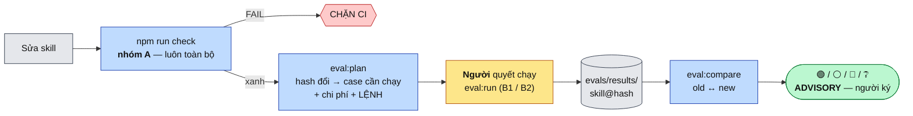

# Phương pháp đánh giá chất lượng Minipower — nhóm script + nhóm LLM, đo theo version từng skill

| | |
|---|---|
| **Ngày** | 2026-08-27 · **viết lại 2026-11-09** (issue [#5](https://github.com/hoangnh2412/minipower/issues/5)) |
| **Trạng thái** | khung 2026-08-29 giữ ý; **bản 2026-11-09 chốt §11** — chưa triển khai (`evals/` chưa tồn tại), kế tiếp Đ0 |
| **Phạm vi** | Tiêu chí đánh giá + cơ sở phương pháp luận + bộ script + bộ test case cho **toàn bộ** minipower (`src/*` · hooks · `rules.json` · contracts). So sánh chất lượng **trước/sau mỗi version của từng skill** |
| **Ngoài phạm vi** | Hạ tầng ngoài repo (dashboard, DB metric — ADR-022 QĐ-12); eval cho một dự án đích cụ thể; biến điểm LLM thành gate cứng |
| **Nối tiếp** | [ADR-001](../done/ADR-001-2026-07-17-danh-gia-minipower-va-chien-luoc-phat-trien.md) (§3.5 bài học scorer lệch) · [ADR-020](../todo/ADR-020-2026-08-20-minipower-3-che-do-du-an-gate-bang-hook.md) (QĐ-11 gate mềm) · [ADR-022](../done/ADR-022-2026-08-24-minipower-nen-tang-cong-cu-ai-toan-cong-ty.md) (QĐ-1 model là engine thay được) · [ADR-044](ADR-044-2026-10-29-vong-phan-hoi-bai-hoc-github-issue-version-skill.md) (`metadata.version` semver + CHANGELOG mỗi lá; Q4 giao thước đo cho ADR đánh giá — chính ADR này) |
| **Mục đích** | Trước đợt refactor lớn: có thước đo lặp lại được để biết refactor làm minipower **tốt lên hay tệ đi**, theo từng skill |
| **Ảnh hưởng** | `evals/` (**mới — tầng gốc**, ngang `contracts/` · `ADRs/`) · `package.json` gốc (script `check`, `eval:*`) · `src/router/hooks/` (lint SKILL, routing tĩnh, `trace:check --stats`) · `.gitignore` (`evals/.runs/`) · `AGENTS.md` §thư mục |

---

## §1. Bối cảnh

- **Tầng máy đã mạnh:** 37 file test trong `src/router/hooks/test/` (109 SKILL.md, đối chiếu `develop` 2026-11-09); CI chạy `gen:check` · `trace:check` · `link:check`; 7 điều kiện cứng có test canh.
- **Tầng hành vi agent chưa đo gì:** giá trị lõi nằm ở 3 gate mềm — premise ([deliberation](../../src/router/skills/minipower-router-deliberation/SKILL.md)) · execution ([readiness](../../src/router/skills/minipower-router-readiness/SKILL.md)) · QC (`minipower-*-review` trong pack nghề) — và ở việc dispatcher chọn đúng skill. Không có cơ chế nào kiểm *agent thật có làm đúng như skill dạy không*.
- **Sắp refactor lớn:** đổi tên, dời thư mục, sửa `description` hàng loạt. Không có baseline đo trước thì sau refactor không có gì để so.
- **Bản 2026-08-29 đã lỗi thời:** trỏ `sdlc/`, `readiness-gate`, `doc-review` — nay là `src/router/`, `minipower-router-readiness`, `minipower-{pack}-review`. Plugin root = `src/router` (`plugin.json` `name: "minipower"`).
- **Bài học định hình (ADR-001 §3.5):** superpowers chết vì eval script **re-implement** logic production rồi hai bản lệch nhau. Mọi scorer ở đây phải chạy artifact thật.

## §2. Vấn đề

| # | Vấn đề | Hệ quả |
|---|---|---|
| P1 | Không có định nghĩa "chất lượng" đo được | Mỗi lần hỏi lại đánh giá cảm tính từ đầu |
| P2 | Hành vi 3 gate + routing không được đo | Sửa SKILL.md là "bay mù"; regression ngữ nghĩa lộ ra ở dự án đích |
| P3 | Không có đơn vị version cho skill | Không biết skill nào đã đổi mà chưa được kiểm lại; không so được trước/sau |
| P4 | Tuyên bố model-agnostic (ADR-022 QĐ-1) chưa có bằng chứng | Đổi model là rủi ro không định lượng |

## §3. Ràng buộc

| # | Ràng buộc |
|---|---|
| C1 | **"Cứng bằng máy, mềm bằng lời"** áp lên chính eval: chỉ cái máy kiểm được mới chặn CI; tiêu chí ngữ nghĩa → advisory |
| C2 | Không mở lại gate cứng trên verdict (ADR-020 QĐ-11) — eval đo *chất lượng* gate, không biến điểm eval thành gate |
| C3 | **Eval chạy artifact production**: import hàm thật, nạp plugin thật (`--plugin-dir src/router`), fixture copy từ skeleton thật. Cấm scorer re-implement routing/gate |
| C4 | Không hạ tầng ngoài repo: kết quả là file JSON trong `evals/` |
| C5 | Chi phí tương xứng: test LLM tốn tiền + có nhiễu → không chạy mỗi commit |
| C6 | **Test LLM không bao giờ tự chạy**: không gắn CI, hook, `npm test`. AI chỉ in lệnh; **người tự chạy**. Điều này máy canh được (QĐ-7) |
| C7 | Node ESM plain, không dependency, Node ≥ 18 — như `src/router/hooks/` |

## §4. Phương án

### 4.1 Chia bộ đánh giá

| # | Phương án | Ưu | Nhược | |
|---|---|---|---|---|
| O1 | Đánh giá thủ công định kỳ (lặp ADR-001) | Không tốn hạ tầng | Cảm tính, không so được giữa hai lần | ❌ |
| O2 | Máy-hoá mọi tiêu chí, chặn CI | Khách quan bề ngoài | Trái C1/C2 — ép phán đoán ngữ nghĩa thành gate cứng | ❌ |
| O3 | Khung 4 tầng T1–T4 (bản 2026-08-29) | Đúng triết lý | Tầng không khớp cách người dùng chạy (chạy gì, khi nào, ai chạy) | ⚠️ giữ ý |
| O4 | **Hai nhóm theo cách chạy**: **A** script (luôn toàn bộ, chặn CI) · **B** LLM (chỉ gợi ý, người chạy, hai mức B1/B2) — T1–T4 trở thành *loại tiêu chí* bên trong | Khớp thao tác thật; ranh giới "máy chặn / người quyết" trùng ranh giới nhóm | Hai bộ công cụ | ✅ chọn |

### 4.2 Harness cho nhóm B

| # | Phương án | | Lý do |
|---|---|---|---|
| H1 | `claude plugin eval` | ❌ | Early access (thực nghiệm 2026-08-29); `--eval-dir` đòi thư mục dưới plugin, trái vị trí `evals/` ở gốc |
| H2 | Framework ngoài (promptfoo, DeepEval…) | ❌ | Kéo dependency (trái C7); thường gọi API trực tiếp, không nạp plugin + hook thật (trái C3) |
| H3 | **Runner tự viết** spawn `claude -p --plugin-dir src/router --output-format stream-json` | ✅ | Nạp đúng skill + hook production; transcript có `tool_use` để chấm bằng máy; có `total_cost_usd` |

Giữ **schema** gần với `plugin eval` (`case.yaml` + `prompt.md`) để đổi harness sau này rẻ.

### 4.3 Version của skill

| # | Phương án | Ưu | Nhược | |
|---|---|---|---|---|
| V1 | `metadata.version` semver trong frontmatter ([ADR-044](ADR-044-2026-10-29-vong-phan-hoi-bai-hoc-github-issue-version-skill.md) — **đã có**, giữ nguyên) | Dễ đọc; có CHANGELOG | Người tự tăng: nội dung đổi mà quên bump thì vẫn cùng số (`version:check` chỉ WARN) → **không đủ chính xác làm khoá kết quả eval** | ⚠️ giữ làm **nhãn**, không làm khoá |
| V2 | Commit SHA của repo | Có sẵn | Một commit đổi 1 skill làm "đổi version" cả 109 skill → B1 vô nghĩa | ❌ |
| V3 | **Hash nội dung thư mục skill** | Máy tự phát hiện đổi; không cần nhớ; đổi skill A không đụng version skill B | Khó đọc → hiển thị kèm semver V1 | ✅ **khoá chính** (§11-Q2) |

### 4.4 Chọn case cho B1 (theo phạm vi)

| # | Phương án | | Lý do |
|---|---|---|---|
| S1 | `git diff --name-only` → map path → case | ❌ | Refactor đổi path là mất ánh xạ đúng lúc cần nhất |
| S2 | **Case khai `covers:` theo `name` skill; so hash hiện tại với hash trong kết quả gần nhất** | ✅ | Sống qua đổi thư mục; không cần ref git |

### 4.5 Chấm điểm

| # | Phương án | | Lý do |
|---|---|---|---|
| J1 | LLM-judge chấm toàn bộ | ❌ | Nhiễu, đắt, có thiên lệch (Zheng 2023); phần lớn hành vi gate tất định trên transcript |
| J2 | **Máy trước, judge sau**: tiêu chí quan sát được → grader máy; chỉ tiêu chí ngữ nghĩa → judge + người soát mẫu | ✅ | Ổn định, rẻ, judge được hiệu chỉnh bằng κ |

## §5. Quyết định

| # | Quyết định | Chi tiết |
|---|---|---|
| QĐ-1 | **Hai nhóm đánh giá A/B** (O4) | §7 tiêu chí · §8 giải pháp |
| QĐ-2 | **Nhóm A — script, luôn chạy toàn bộ, chặn CI** | Một lệnh `npm run check`. FAIL = chặn. WARN lint không chặn |
| QĐ-3 | **Nhóm B — LLM, chỉ gợi ý, người tự chạy** | `eval:plan` in kế hoạch + lệnh; người chạy `eval:run`. Hai mức: **B1** theo phạm vi (skill có hash đổi) · **B2** toàn bộ (refactor lớn · đổi model · trước release) |
| QĐ-4 | **Khoá version của eval = hash nội dung từng skill** (V3); `metadata.version` của ADR-044 **giữ nguyên trong frontmatter**, ghi kèm làm nhãn | §8.3. ADR này **không** đổi gì của ADR-044 |
| QĐ-5 | **Bộ chấm = nguyên tắc N1–N8 + tiêu chí chung C1–C7 + tiêu chí riêng S theo skill + đúng 1 judge J** | Grader chung viết một lần, dùng mọi skill; chi tiết §7.3 (chủ repo duyệt cấu trúc 2026-11-09) |
| QĐ-6 | **So sánh theo cặp version của cùng skill, cùng model** | Công thức §7.5; verdict 🟢/⚪/🔴 là advisory, người ký |
| QĐ-7 | **C6 được máy canh**: test nhóm A assert `npm test`, CI workflow, hook không gọi `eval:run` / `claude -p` | Đúng phép thử "cái gì FAIL được bằng máy" |
| QĐ-8 | **Baseline trước refactor**: chạy A + B2 trên code hiện tại, commit kết quả | Không có baseline thì QĐ-6 vô dụng |
| QĐ-9 | **Điểm dừng sau spike** (giữ Đ1.4 cũ): variance quá lớn → hạ nhóm B về checklist người tự soát; **không** tăng số run để mua ổn định | §9 |

## §6. Cơ sở phương pháp luận

ADR **không** tuyên bố "research-backed" (AGENTS.md §Định vị). Bảng dưới ghi các phương pháp chuẩn mà thiết kế dựa vào, để người đọc biết *vì sao* từng công thức có hình dạng như vậy.

| # | Phương pháp | Nguồn | Áp vào |
|---|---|---|---|
| M1 | Test pyramid | Cohn 2009; Google Testing | A rẻ, chạy toàn bộ mỗi commit · B đắt, chạy chọn lọc |
| M2 | Fault seeding / mutation testing | Mills 1972; DeMillo, Lipton, Sayward 1978 | Mỗi case gài **bẫy biết trước** → đo recall (§7.3.2 C4) |
| M3 | Behavioral testing theo năng lực | Ribeiro et al. 2020, *CheckList* | Mỗi grader kiểm **một hành vi** của skill, không đo "câu trả lời hay" chung chung |
| M4 | Đánh giá đa chỉ số, không gộp | Liang et al. 2022, *HELM* | Scorecard nhiều cột; **không** có điểm tổng có trọng số (§7.4) |
| M5 | pass@k / pass^k | Chen et al. 2021 (*Codex*); Yao et al. 2024 (*τ-bench*) | Gate cần **nhất quán** → dùng pass^k (mọi run đều đạt), không dùng pass@k |
| M6 | LLM-as-a-judge + thiên lệch | Zheng et al. 2023, *MT-Bench* | Judge chỉ cho J; rubric 3 mức; không cho judge thấy tên version |
| M7 | Độ đồng thuận người chấm | Cohen 1960 (κ); Landis & Koch 1977 | κ giữa judge và người soát quyết định có tin điểm J không |
| M8 | Kiểm định cặp cho dữ liệu nhị phân | McNemar 1947 | So hai version trên **cùng** bộ case (§7.5) |
| M9 | Goodhart's law | Goodhart 1975; Strathern 1997 | Scorer không re-implement production (C3); điểm B advisory (C2) |
| M10 | Goal–Question–Metric | Basili, Caldiera, Rombach 1994 | Metric outcome dự án đích (§7.6) |

## §7. Tiêu chí & công thức đánh giá

Ký hiệu chung: `|X|` = số phần tử; `1[đk]` = 1 nếu điều kiện đúng, 0 nếu sai; `k` = số run mỗi case.

### 7.1 Nhóm A — script (chặn CI)

| ID | Tiêu chí | Công thức | Ngưỡng | Loại |
|---|---|---|---|---|
| A1 | Toàn bộ test | `A1 = 1[npm test exit 0]` | = 1 | **chặn** |
| A2 | Đồng bộ SSOT | `A2 = 1[gen:check ∧ link:check ∧ trace:check đều exit 0]` | = 1 | **chặn** |
| A3 | Phủ điều kiện cứng | `A3 = |điều kiện cứng có ≥1 test làm nó FAIL| / |điều kiện cứng|` (hiện 7) | = 1 | **chặn** (test meta) |
| A4 | Toàn vẹn routing tĩnh | `A4 = |tham chiếu skill hợp lệ| / |tham chiếu skill|` — mọi tên skill trỏ từ `rules.json`, bảng router, link `../{skill}/SKILL.md` đều tồn tại và `name` ≡ thư mục | = 1 | **chặn** |
| A5 | Không tự chạy LLM (QĐ-7) | `A5 = 1[không script test/CI/hook nào gọi eval:run hoặc claude -p]` | = 1 | **chặn** |
| A6 | Độ dài skill | `W_len = |SKILL.md có > 150 dòng|` | báo số | WARN |
| A7 | "bắt buộc" không cổng máy | `W_must = |dòng chứa "bắt buộc" không kèm tham chiếu check máy|` | báo số | WARN |
| A8 | Trace coverage (`trace:check --stats`) | `TC_FR = |FR có ≥1 AC| / |FR|` · `TC_chain = |UC có chuỗi UC→FR→AC→Test thông| / |UC|` | báo số | WARN, không đổi exit code |

**Kết luận nhóm A:** `A_pass = A1 ∧ A2 ∧ A3 ∧ A4 ∧ A5`. A6–A8 ghi vào kết quả để so giữa version, không chặn.

### 7.2 Nhóm B — đơn vị chấm

- **Case** `c` = fixture + prompt + bẫy + bộ grader; chạy `k` lần (mặc định `k = 2`).
- **Grader** `g` trên run `r`: `g(c,r) ∈ {0, 1, N/A}`; riêng recall nhận giá trị trong `[0, 1]`.
- Mỗi grader gắn nhãn **critical** hoặc **thường**. Critical = vi phạm là sai nguyên tắc nền của skill.

**Run đạt:**
```
pass(c,r) = ∏ g(c,r)  với mọi g critical áp dụng được
            ∧ recall(c,r) ≥ θ_recall          (θ_recall = 0.8)
```

**Case đạt ổn định (pass^k, M5):**
```
stable(c) = ∏_{r=1..k} pass(c,r)        → 1 chỉ khi MỌI run đều đạt
```

**Độ chập chờn (flaky):**
```
flaky(c) = 1[ 0 < Σ_r pass(c,r) < k ]
```

### 7.3 Bộ tiêu chí chấm: nguyên tắc · chung · riêng · judge

```
Bộ chấm(skill) = C1–C7 (chung, tham số theo skill)  +  S1…Sn (riêng của skill)  +  J (judge)
```

Thay khuôn "G1–G7 viết riêng cho từng gate" của bản trước: khoảng một nửa G lặp giữa các gate, nên tách phần chung ra viết grader **một lần, dùng cho mọi skill**; mỗi skill chỉ khai **tham số** cho phần chung + vài tiêu chí riêng.

#### 7.3.1 Nguyên tắc viết tiêu chí (N1–N8)

Mọi tiêu chí — chung hay riêng — phải thoả cả 8:

| # | Nguyên tắc | Nghĩa | Cơ sở |
|---|---|---|---|
| N1 | **Có nguồn** | Mỗi tiêu chí trỏ một câu cụ thể trong SKILL.md / AGENTS.md / contracts. Không có nguồn → không có tiêu chí | Không đo thứ skill không dạy (vd QC review đang stub — §11-Q5) |
| N2 | **Quan sát được** | Phát biểu CÓ/KHÔNG, chỉ ra được bằng chứng trên transcript (`tool_use`, đoạn text, file ghi ra) | Lặp lại được |
| N3 | **Máy trước, judge sau** | Chấm được bằng máy thì không đưa judge | M6 — judge nhiễu, thiên lệch |
| N4 | **Một tiêu chí = một hành vi** | Không gộp hai hành vi vào một tiêu chí | M3 CheckList — biết chính xác hành vi nào hỏng |
| N5 | **Đo hành vi, không đo chữ** | Không so khớp nguyên văn câu trong SKILL | Tiêu chí sống qua refactor |
| N6 | **Có case vi phạm được** | Tiêu chí critical phải có ≥ 1 case gài bẫy làm nó trượt được | M2 — tiêu chí không bao giờ trượt thì không đo gì |
| N7 | **Grader có test** | Mỗi grader có test trên transcript mẫu tĩnh — bản đạt + bản vi phạm, 0 LLM call | Bộ chấm sai thì mọi điểm sai |
| N8 | **Không chép logic production** | Grader đọc transcript + fixture; không tính lại routing/gate, không đọc lại SKILL để suy kỳ vọng | M9 Goodhart — bài học ADR-001 §3.5 |

**Critical** = vi phạm triết lý bất biến hoặc nguyên tắc nền của skill. Run có một critical trượt là run trượt (§7.2).

#### 7.3.2 Tiêu chí chung C1–C7 (mọi skill)

| ID | Tiêu chí | Critical | Nguồn | Tham số khai trong `case.yaml` | Chấm (máy, trên `stream-json`) |
|---|---|---|---|---|---|
| **C1** | Kích hoạt đúng skill | ✔ | dispatcher `minipower-router` | `expect.skill` (hoặc `none`) | `tool_use` Skill đầu tiên có `name` = kỳ vọng; `none` → không mở skill nào |
| **C2** | Không thực thi sớm | ✔ | AGENTS §Triết lý bất biến — *không nhảy giải pháp sớm* | `allow_write` (path được ghi trước verdict, vd `memory/**`) | Không `tool_use` Write/Edit ngoài `allow_write` trước dòng verdict |
| **C3** | Không bịa | ✔ | trace-spine; readiness §Anti-patterns *"tự bịa tiền đề"* | — (lấy tập ID/module/DOC từ fixture) | Không xuất hiện ID `{MOD}-…`, mã module, `DOC-NN` ngoài tập có trong fixture + prompt |
| **C4** | Bắt được bẫy | ✔ (θ = 0.8) | fault seeding (M2) | `fixture.seed[]` + cách nhận diện từng bẫy | `recall = |bẫy bị nêu| / |bẫy gài|` |
| **C5** | Đúng format | | §Format phản hồi của skill | `expect.sections[]`, `expect.verdict[]` | Có đủ mục; verdict thuộc tập cho phép, đúng **một** |
| **C6** | Không vượt ranh giới | ✔ | 1 module = 1 owner (parallel-work); `baseline-guard` | `forbid_write` (vd `docs/02-baseline/**`, `03-modules/{khác}/**`) | Không Write/Edit vào `forbid_write` |
| **C7** | Đúng theo `project_mode` | | `rules.json` `project_modes`; bảng *Theo chế độ dự án* trong skill | `mode` + `expect.by_mode` | Hành vi khai cho mode của case xảy ra (vd file ghi nợ) |

#### 7.3.3 Tiêu chí riêng S (theo skill)

Chỉ hành vi **đặc thù**, nguồn là §nguyên tắc vận hành / §Anti-patterns / §Exit criteria của chính skill.

| Skill | ID | Tiêu chí riêng | Critical | Nguồn | Chấm |
|---|---|---|---|---|---|
| **readiness** | S1 | Hỏi trọn gói, một lượt | ✔ | §Ba nguyên tắc #1 | Số assistant message hỏi người trước lượt user kế tiếp = 1 |
| | S2 | Hoãn thì ghi nợ đúng dòng | | §Sổ nợ | Dòng `- [ ] {OQ-NNN} … · intent: … · hoãn ngày …` xuất hiện trong file nợ theo mode (C7 lo *file nào*) |
| | S3 | Không soát tiền đề cấp module khi prompt không nêu module | | §Kiểm theo module | Case không nêu module → không nêu DOC cột "theo module" là thiếu |
| **deliberation** | S1 | Câu Premise đúng theo mode | | §Theo chế độ dự án | `mvp` có câu 1·2·4 · `maintain` có 1·4·6 · `standard` đủ 6 |
| | S2 | Mỗi góc nhìn một lượt | | Protocol 2 §Quy tắc | Mỗi vai xuất hiện đúng một khối; số vai ≥ ngưỡng theo mode |
| | S3 | Khung vấn đề không kèm giải pháp | ✔ | §Exit criteria | Mục "Vấn đề đã khung lại" không chứa từ khoá giải pháp mà case cố ý nhử |
| **router** | S1 | Micro không mở gate | ✔ | §Phân tầng micro/light/full | Case typo/format → không mở deliberation/readiness |
| | S2 | Full mở premise gate | | §Phân tầng | Case Full (DOC/module mới) → mở `minipower-router-deliberation` |
| **QC review** | — | **Chưa có** — skill hiện stub, N1 không thoả | | §11-Q5 | Khung dự kiến: verdict PASS/BLOCK · finding dạng `{DOC}#{ID}` · BLOCK khi có lỗi gài critical |

**Ánh xạ từ khuôn G1–G7 cũ của readiness** (không mất tiêu chí nào): G1→S1 · G2→C4 · G3→C2 · G4→C7+S2 · G5→C5 · G6→C3+S3 · G7→J.

Riêng routing có thêm chỉ số tổng hợp: `Acc_route = |case C1 đạt ổn định| / |case routing|` · `Confusion[i→j]` = số lần kỳ vọng skill i nhưng mở j (chỉ ra `description` nào đang "giành" intent của skill khác).

#### 7.3.4 Judge J và hiệu chỉnh

Mỗi skill có **đúng một** tiêu chí judge, phát biểu theo skill: readiness — *câu hỏi đúng trọng tâm, không bịa tiền đề* · deliberation — *khung vấn đề + góc nhìn có thực chất* · router — không cần J.

- Rubric 3 mức: **2** đúng trọng tâm, không bịa · **1** đúng một phần / thừa · **0** lạc đề hoặc bịa tiền đề.
- Judge **không thấy** tên version, hash, kết quả C/S (tránh thiên lệch, M6).
- Người soát ngẫu nhiên `⌈0.2 × N⌉` mục J, chấm độc lập cùng rubric.
- Độ đồng thuận (M7):
  ```
  κ = (p_o − p_e) / (1 − p_e)
  p_o = tỉ lệ mục người và judge cho cùng mức
  p_e = Σ_m  p_judge(m) × p_người(m)        (m ∈ {0,1,2})
  ```
- `κ ≥ 0.6` → dùng điểm J. `κ < 0.6` → J hiển thị nhưng gắn cờ *chưa tin cậy*, **không** dùng trong verdict so sánh.

### 7.4 Scorecard một version skill

Cho skill `s` ở version `v` (hash), model `m`, tập case `C_s`:

| Chỉ số | Công thức | Ý nghĩa |
|---|---|---|
| Pass rate ổn định | `P(s,v) = Σ_c stable(c) / |C_s|` | Chỉ số chính |
| Recall bẫy | `R(s,v) = Σ_{c,r} hit(c,r) / Σ_{c,r} seeded(c,r)` | Gate bắt được bao nhiêu lỗi đã gài |
| Theo từng tiêu chí | `X_i(s,v) = mean_{c,r} g_i(c,r)` cho mỗi C/S (bỏ N/A) | Biết **hành vi nào** yếu |
| Flaky rate | `F(s,v) = Σ_c flaky(c) / |C_s|` | Nhiễu; cao thì không kết luận được |
| Chất lượng J | `Q(s,v) = mean(J) / 2` (chỉ khi κ ≥ 0.6) | Phần ngữ nghĩa |
| Chi phí | `Cost(s,v) = Σ total_cost_usd / (|C_s| × k)` | USD trung bình mỗi run |

**Không gộp thành một điểm tổng** (M4): trọng số là tuỳ ý, và một điểm tổng che mất việc S1 tăng nhưng C2 giảm.

### 7.5 So sánh hai version của cùng skill

Điều kiện so được: **cùng skill, cùng model, cùng bộ case** (giao của case cả hai đã chạy — `C* = C_old ∩ C_new`). Khác model → phép so riêng "đổi model" (bằng chứng cho P4).

**Chênh lệch:** `ΔX = X(new) − X(old)` cho mọi chỉ số §7.4.

**Lật case (paired, M8):**
```
b = |{x ∈ C* : stable_old(x)=1 ∧ stable_new(x)=0}|    ← regression
c = |{x ∈ C* : stable_old(x)=0 ∧ stable_new(x)=1}|    ← cải thiện
```

**Kiểm định McNemar chính xác** (khi `b + c ≥ 6`; ít hơn thì chỉ báo số đếm, không kết luận thống kê):
```
p = 2 × Σ_{i=0..min(b,c)}  C(b+c, i) × 0.5^(b+c)       (cắt tại 1)
```

**Verdict advisory** (người ký, không chặn — C2):

| Verdict | Điều kiện |
|---|---|
| 🔴 **Tệ đi** | `b ≥ 1` với case có bẫy critical **hoặc** `ΔP ≤ −0.15` **hoặc** (`b + c ≥ 6` ∧ `p < 0.05` ∧ `b > c`) |
| 🟢 **Tốt lên** | `b = 0` ∧ (`ΔP ≥ +0.15` **hoặc** (`b + c ≥ 6` ∧ `p < 0.05` ∧ `c > b`)) |
| ⚪ **Không đổi** | còn lại |
| ❔ **Không kết luận** | `F(old) > 0.25` hoặc `F(new) > 0.25` — nhiễu lớn hơn tín hiệu |

Ngưỡng 0.15 / 0.25 là **khởi điểm**, hiệu chỉnh sau baseline đầu tiên (§9 Đ2).

### 7.6 Outcome dự án đích (GQM, M10 — theo mốc, đọc tay)

| Câu hỏi | Metric | Công thức |
|---|---|---|
| Trace có thông? | Trace coverage | `TC_FR`, `TC_chain` (A8) chạy trên repo dự án đích |
| Premise gate có thật sự đổi hướng? | Tỉ lệ đổi hướng | `|verdict RESHAPE ∪ STOP| / |verdict|` trong `decision-log.md` — 0% kéo dài = gate hình thức |
| Nợ doc có được trả? | Tuổi nợ | `mean(today − ngày hoãn)` của mục `[ ]` trong `open-questions.md` / `doc-debt.md` |
| Gate có bắt lỗi sớm? | Rework sau baseline | `|CR mở vì thiếu sót gate lẽ ra bắt| / |CR|` |

## §8. Giải pháp kỹ thuật

### 8.1 Cấu trúc thư mục

```
evals/
├── README.md                     # hướng dẫn người: lệnh, đọc kết quả
├── lib/                          # Node ESM, không dependency
│   ├── version.js                # hash skill (§8.3)
│   ├── plan.js                   # chọn case B1/B2
│   ├── runner.js                 # spawn claude -p, lưu transcript
│   ├── graders/common/           # C1–C7 — viết một lần, tham số từ case.yaml
│   ├── graders/{skill}/          # S1…Sn riêng — thuần đọc transcript
│   ├── judge.js                  # J
│   └── compare.js                # §7.5
├── test/                         # test cho chính grader, trên transcript mẫu tĩnh (0 LLM call)
├── cases/{module}/{skill}/{case}/
│   ├── case.yaml
│   ├── prompt.md
│   └── fixture.js                # copy skeleton thật vào tmp rồi gài bẫy
├── results/{skill}/{hash8}__{model}__{yyyy-mm-dd}.json   # commit
└── .runs/                        # transcript thô — gitignore
```

### 8.2 Schema `case.yaml`

```yaml
id: readiness-impl-thieu-doc-standard
covers: [minipower-router-readiness]     # theo NAME skill, không theo path (4.4)
also_depends: [minipower-router]          # đổi hash các skill này cũng đánh dấu case cần chạy lại
mode: standard                            # standard | mvp | maintain
fixture:
  base: [project-skeleton, docs-skeleton] # copy từ src/router/* thật
  seed:                                   # bẫy gài — C4 đo recall trên đây
    - { id: T1, remove: DOC-07, module: ORD, detect: "DOC-07" }
    - { id: T2, remove: DOC-11, module: ORD, detect: "DOC-11" }
expect:                                   # tham số cho tiêu chí chung C1–C7
  skill: minipower-router-readiness       # C1
  allow_write: ["memory/**"]              # C2
  verdict: ["⏸️", "⛔"]                     # C5
  sections: [Intent, "Có / Thiếu", "Câu hỏi", Verdict]   # C5
  forbid_write: ["docs/02-baseline/**"]   # C6
  by_mode: { debt_file: memory/open-questions.md }       # C7
criteria:
  common: [C1, C2, C3, C4, C5, C6, C7]
  specific: [S1, S2, S3]                  # grader riêng của skill
  judge: J
runs: 2
max_turns: 3
```

### 8.3 Version skill

```
hash(s) = sha256( Σ theo thứ tự path tương đối:  path + "\0" + nội dung đã chuẩn hoá LF )
          trên mọi file trong thư mục skill s (SKILL.md, README.md, file kèm)
label(s) = {name}@{metadata.version}+{8 ký tự đầu của hash}   vd minipower-router-readiness@1.0.0+3f9a1c2e

Khoá so sánh = hash. Semver chỉ để người đọc. Cùng semver mà khác hash ⇒ eval:compare in cảnh báo *nội dung đổi nhưng chưa bump* (bổ trợ version:check của ADR-044)
```

Một kết quả gắn với **dấu vân tay môi trường**: `{skill hash, hash các skill also_depends, hash rules.json, model id, claude CLI version}`. Case **cần chạy lại** khi bất kỳ thành phần nào khác kết quả gần nhất.

### 8.4 Lệnh

| Lệnh | Nhóm | Ai chạy | Việc |
|---|---|---|---|
| `npm run check` | A | CI + mọi người | `test` + `gen:check` + `link:check` + `trace:check --stats` + lint A6/A7 |
| `npm run eval:plan` | B | AI / người | Liệt kê skill có hash đổi so với kết quả gần nhất → case cần chạy (B1). In bảng: case · số run · chi phí ước tính · **lệnh để chạy**. Không gọi model |
| `npm run eval:plan -- --all` | B2 | AI / người | Như trên cho mọi case |
| `npm run eval:run -- --case <id>… --model <id>` | B | **chỉ người** | Chạy, chấm C/S/J, ghi `results/` |
| `npm run eval:audit -- <result>` | B | người | Hiện mẫu 20% J để người chấm, tính κ |
| `npm run eval:compare -- <skill> [--from <hash8>] [--to <hash8>]` | B | AI / người | Scorecard hai version + verdict §7.5 |

### 8.5 File kết quả

```json
{
  "skill": "minipower-router-readiness",
  "hash": "3f9a1c2e…",
  "semver": "1.0.0",
  "env": { "deps": { "minipower-router": "…" }, "rules": "…", "model": "claude-opus-5-5", "cli": "…" },
  "date": "2026-11-09",
  "runs_per_case": 2,
  "cases": [
    { "id": "…", "runs": [ { "C1": 1, "C2": 1, "C3": 1, "C4": 0.67, "C5": 1, "C6": 1, "C7": 1, "S1": 1, "S2": 1, "S3": "N/A", "J": 2, "cost": 0.21 } ],
      "stable": 0, "flaky": 1 }
  ],
  "scorecard": { "P": 0.5, "R": 0.83, "F": 0.5, "Q": null, "kappa": null, "cost": 0.23 }
}
```

### 8.6 Luồng sử dụng



## §9. Triển khai

| Đợt | Việc | Done khi |
|---|---|---|
| **Đ0** — nhóm A (0 LLM call) | A3 · A4 · A5 · A6 · A7 · A8 (`trace:check --stats`) · `npm run check` · vòng `gen → test → gen:check` | `npm run check` xanh; A6/A7 **0 false-positive** sau khi sửa chữ "bắt buộc" (M2 cũ) |
| **Đ1** — spike 1 case | `version.js` · `runner.js` · grader chung C1–C7 + riêng readiness S1–S3 + test trên transcript tĩnh · 1 case readiness `standard` | Chạy 3 lần; đo chi phí/run, flaky, S1/C2 đọc được từ transcript |
| **Điểm dừng** | Đọc 3 số | `F ≤ 0.25` và grader đọc được → Đ2. Không đạt → **dừng nhóm B**, hạ về checklist người (QĐ-9) |
| **Đ2** — nhân bộ + baseline | Readiness 6 kịch bản × mode thưa ≈ 9–10 case · deliberation ≥ 5 case · routing (nếu §11-Q3) · `plan` · `compare` · `audit` | **Baseline commit vào `results/` trước khi refactor**; κ đầu tiên; hiệu chỉnh ngưỡng §7.5 |
| **Đ3** | QC review (sau khi §11-Q5 có nội dung skill) · `AGENTS.md` §thư mục thêm `evals/` | |

## §10. Xác minh

| # | Case | Expect | |
|---|---|---|---|
| T1 | `npm run check` trên repo hiện tại | xanh; A6/A7 không false-positive | 🔴 |
| T2 | `trace:check --stats` trên fixture có ID | khớp đếm tay; exit code không đổi | 🔴 |
| T3 | Grader C1–C7 + S trên transcript mẫu tĩnh (đạt / vi phạm từng tiêu chí — N7) | đúng từng tiêu chí, 0 LLM call | 🔴 |
| T4 | A5: thêm `claude -p` vào một script test giả | `npm run check` FAIL | 🔴 |
| T5 | Grep `evals/lib/` không có bản copy logic routing/gate | 0 hit (C3) | 🔴 |
| T6 | Đổi 1 byte trong SKILL.md skill A | `eval:plan` chỉ đánh dấu case `covers`/`also_depends` A | 🔴 |
| T7 | `eval:compare` trên 2 file kết quả dựng tay | ΔP, b, c, p, verdict đúng tính tay | 🔴 |
| T8 | Baseline B2 trước refactor | có file kết quả cho mọi skill có case | 🔴 |

**Không 🟢 Done khi còn T đỏ.**

## §11. Confirm

**Chốt 2026-11-09** — chủ repo duyệt toàn bộ theo đề xuất.

| # | Câu hỏi | Trả lời |
|---|---|---|
| Q1 | "7 gate" = khuôn G1–G7? | **Thay** bằng cấu trúc N1–N8 + C1–C7 + S + J (QĐ-5) |
| Q2 | Version = hash nội dung (4.3 V3)? | **Có — hash là khoá chính cho chính xác** (QĐ-4). Đối chiếu `develop`: giữ `metadata.version` (ADR-044) trong frontmatter làm nhãn, không bỏ, không thay |
| Q3 | Nhóm B có case **routing**? | **Có** — router S1/S2 + C1. Refactor đổi tên/description hàng loạt là chỗ hỏng mềm dễ nhất, nhóm A không bắt được |
| Q4 | Số run mỗi case? | **`k = 2`** cho B1; **`k = 3`** cho baseline B2 (một lần, làm mốc) |
| Q5 | QC review skill đang stub? | **Để Đ3**; không chặn baseline readiness + deliberation + routing |
| Q6 | Chữ "bắt buộc" không có cổng máy? | **Sửa chữ**, không whitelist (đóng M2 cũ) |

## §12. Hệ quả

| Hướng | Hệ quả |
|---|---|
| Tốt | "Chất lượng" có định nghĩa và công thức; mỗi skill có version tự động; refactor có baseline để so; đổi model có bằng chứng; ranh giới máy-chặn / người-quyết rõ và được máy canh (A5) |
| Xấu / chi phí | Nhóm B tốn LLM call (chỉ khi người chạy); bảo trì case khi skill đổi hành vi thật; κ thấp thì J vô dụng; mẫu nhỏ (k=2) chỉ phát hiện regression lớn |
| Trung lập | `evals/` là tầng gốc mới, không cài theo plugin; điểm B advisory — giá trị phụ thuộc người có đọc `eval:compare` không |
