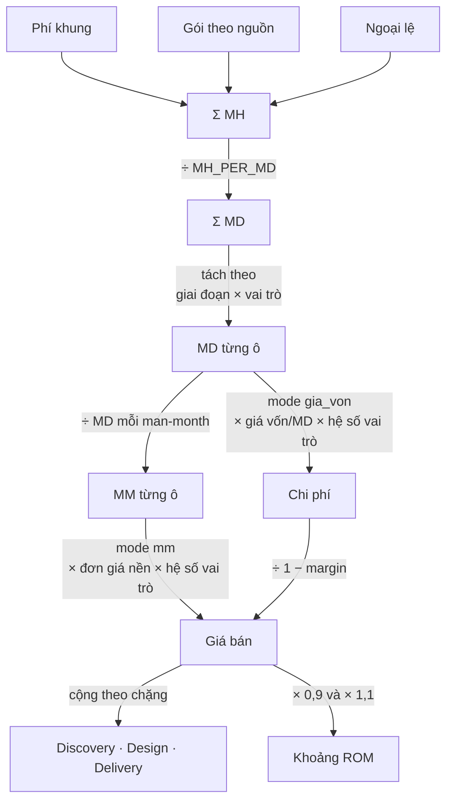

# Hướng dẫn thực thi — tiêu chuẩn `PRESALES-DMBA-STD`

| | |
|---|---|
| Áp dụng cho | `PRESALES-DMBA-STD` v2.5 |
| Engine | `minipower-presales-quotation` |
| Nội dung | Bảng, công thức, quy trình — không phân tích |

Tài liệu này có cấu trúc **Điều khớp 1:1** với [phuong-phap-bao-gia.md](phuong-phap-bao-gia.md) — Điều N ở đây là cách thực thi Điều N bên tiêu chuẩn. Lý do từng cơ chế không lặp lại ở đây; mỗi Điều trỏ ngược sang Điều/Phụ lục tương ứng. Ví dụ chạy số thật (VNA Lakehouse, cả hai `gia_mode`) → [vi-du-vna-lakehouse.md](vi-du-vna-lakehouse.md).

---

# Phần I — Thực thi theo từng điều khoản

## Điều 1. Phạm vi áp dụng

Input tối thiểu để bắt đầu: danh sách hệ thống nguồn + số bảng/field đếm được. Thiếu khảo sát → chạy skill khảo sát trước, không tự suy đoán số đếm.

Dự án phát triển phần mềm → dùng `estimation-ulnl`, không dùng tài liệu này (Điều 1 tiêu chuẩn).

## Điều 2. Thuật ngữ

| `kind` | Số phải đếm (kèm trích nguồn) |
|---|---|
| `ks_ht` | `has_doc` · `dba_ok` · `blocked` · `unstable` |
| `ks_bang` | — (đơn vị cố định) |
| `tq_ng` | `connected` — đã kết nối DB hay chưa |
| `brz` | `fields` · `doc_match` (1-3) · `self_describing` (1-3) — xem Điều 9.1 |
| `slv` | `src_tables` · `cols` · `data_vault` |
| `gld_dim` | `attrs` · `scd2` |
| `gld_fct` | `measures` · `dims` · `grain_unclear` |
| `gld_dm` | `metrics` |
| `gld_kpi` | — (đơn vị cố định) |
| `erd` | `muc` (1-4) — khớp mức Bronze của nguồn, xem Điều 9.1 |
| `logic` | `steps` |
| `map` | `rows` |
| `bc_bg` | `multi_source` |
| `gov` | `doi_tuong` (5 giá trị) · `pham_vi` (0/1/2) — **khách khai**, xem Điều 4.4 |
| `pii_bang` | `fields` · `pii_fields` — xem Điều 9.3 |
| `dq` | — (tách từ adder `CDC_OQ` của dòng Bronze/Silver/Gold gốc, mã `DQ_QC_1`, `qty=0`; không tự dựng, chỉ tạo tay khi tách) |
| `dcat` | — (mã `DCAT1`, 1 dòng/nguồn; GIẢ ĐỊNH chưa hiệu chỉnh trên giờ thực — xem catalog) |
| `ho_tro` | `muc_do` (`nhe` / `sat_sao`) |

Adder đếm được: `PII_F` · `CDC_OQ` · `GRAIN` · `ENUM` · `FK` · `FIRST` · `ROUND` · `EXPORT` · `SOFT_RULE` · `NEST_DEEP`.

Đếm không ra → `unclear: true`. Không tự chọn mã, không tự cộng MH.

## Điều 3. Đơn vị ước lượng

Mỗi dòng mục ghi vào sheet `03-DONGMUC`:

| Cột | Ý nghĩa |
|---|---|
| `STT` | Dẫn xuất — "N.M" (N = thứ tự Nhóm công việc, M = thứ tự trong nhóm), tự tính khi xuất lại |
| `Nhóm công việc` | Dẫn xuất — suy từ `kind` |
| `SL` | Số lượng đơn vị (bảng · entity · nguồn · nhóm…) |
| `reuse_pct` | Giảm do lặp lại — bảng cùng nhóm cùng hình dạng |
| `auto_pct` | Giảm do sinh được bằng script (xem Điều 9) |
| `adjust_pct` | Hệ số điều chỉnh cuối, cộng/trừ tự do |
| `Ngoại lệ` · `Ngoài PV` | Xem Điều 4 |
| `Giai đoạn` · `Vai trò` | Xem Điều 5, 6 |
| 10 cột adder | Xem Điều 2 |

Công thức MH một dòng mục:

```
MH = (Σ(tt+pt+xn) × SL × (1 − reuse_pct) × (1 − auto_pct) + Σ adder) × (1 + adjust_pct)
```

`tt`/`pt`/`xn` tra theo mã trong `01-CATALOG` (Điều 11).

Cột `Căn cứ / Ghi chú` của mỗi dòng ghi rõ cơ sở số lượng: **`ĐO THẬT`** (đếm được trên tài liệu/DDL, nêu nguồn và ngày đo) hoặc **`GIẢ ĐỊNH`** (nêu cách suy). Hai đại lượng liên hệ số học phải cùng cơ sở — xem Điều 3.5 tiêu chuẩn.

## Điều 4. Cấu trúc giá — ba cấu phần

| # | Cấu phần | Gồm |
|---|---|---|
| 1 | Phí khung (một lần) | 7 mã trong `catalog.nen`: `KHUNG` · `PPL` · `PII_FW` · `QUYDOI` · `GOV` · `GLOSS` · `HOP` (× `so_thang`) |
| 2 | Gói theo nguồn | Σ mh của dòng mục không `ngoai_le`, không `out_of_scope` |
| 3 | Ngoại lệ tính riêng | Σ mh của dòng mục có `ngoai_le = x` |

Cách gán: đặt cột `Ngoại lệ = x` khi hạng mục thuộc Điều 4.3 tiêu chuẩn (chưa được cấp quyền / schema chưa đóng). Đặt `Ngoài PV = x` khi loại hẳn khỏi phạm vi (MH = 0, giữ dòng để thấy đã loại cái gì).

Chuỗi gộp ba cấu phần thành giá bán:



### 4.4. Ma trận phạm vi quản trị & bảo vệ dữ liệu

Giá trị `pham_vi` do **khách khai trong SOW**, không tự chấm. Mỗi đối tượng một dòng `kind=gov`, 5 dòng luôn có mặt trong hồ sơ kể cả khi `pham_vi = 0`.

| `doi_tuong` | Đối tượng | `pham_vi=1` — tham gia | `pham_vi=2` — thiết kế |
|---|---|---|---|
| `qt_qtdl` | Quy trình quản trị dữ liệu | `GOV_QT_1` | `GOV_QT_2` |
| `qc_qtdl` | Quy tắc quản trị dữ liệu (CDE · DQ · metadata catalog) | `GOV_QC_1` | `GOV_QC_2` |
| `tl_qtdl` | Tài liệu / biểu mẫu quản trị dữ liệu | `GOV_TL_1` | `GOV_TL_2` |
| `qt_bvdl` | Quy trình bảo vệ dữ liệu | `BVD_QT_1` | `BVD_QT_2` |
| `qc_bvdl` | Quy tắc bảo vệ dữ liệu (phân loại · MSK/ENC/AC) | `BVD_QC_1` | `BVD_QC_2` |

| `pham_vi` | Nghĩa | Ghi vào `03-DONGMUC` |
|---|---|---|
| `0` | Ngoài phạm vi — khách tự làm | mã `_1`, cột **`Ngoài PV = x`** → MH = 0, dòng vẫn hiện |
| `1` | Tham gia — khách chủ trì, mình góp ý và dự phiên làm việc | mã `_1` |
| `2` | Thiết kế — mình chủ trì, ra tài liệu, khách phê duyệt | mã `_2` |

Chưa khai báo thì ghi `pham_vi = 0` kèm ghi chú "chờ chốt SOW" — **không** bỏ dòng, **không** mặc định là 1 hay 2.

## Điều 5. Giai đoạn

| Chặng | Nội dung | Điều kiện báo giá |
|---|---|---|
| Discovery | Khảo sát, lập inventory, phân loại mức `1`/`2`/`3`, chốt baseline | Báo giá cố định |
| Design | Thiết kế ba tầng | Sau khi inventory Discovery được duyệt |
| Delivery | Hỗ trợ nhẹ sau bàn giao | Thương lượng riêng |

Cột `Giai đoạn` ở `03-DONGMUC`: `discovery` / `design` / `delivery`. Trống → suy từ `kind`:

| kind | Giai đoạn mặc định |
|---|---|
| `ks_ht` · `ks_bang` · `tq_ng` | `discovery` |
| `brz` · `slv` · `gld_dim` · `gld_fct` · `gld_dm` · `gld_kpi` · `erd` · `logic` · `map` · `bc_bg` · `gov` · `pii_bang` | `design` |
| `ho_tro` | `delivery` |

Tham số `so_thang` (mặc định 4) nhân cho hạng mục nền `HOP` ở Điều 4.

## Điều 6. Vai trò

Cột `Vai trò` ở `03-DONGMUC`: `BA` · `DM` · `DA` · `PM`. Trống → `BA`.

| Mã | Vai trò | Hệ số |
|---|---|---:|
| `BA` | Business Analyst — khảo sát, đặc tả | 1,00 |
| `DM` | Data Modeler — thiết kế mô hình | 1,00 |
| `DA` | Data Architect — kiến trúc, chuẩn, review | 1,30 |
| `PM` | Điều phối, workshop, stakeholder | 1,15 |

`don_gia_mm` (hoặc `luong_thang`) ở `00-THAMSO` là mức nền của vai trò hệ số 1,00; vai trò khác nhân hệ số ở sheet `08-VAITRO`. Hệ số trên là mặc định catalog — sửa trực tiếp ở `08-VAITRO` theo Điều 11.6.2 tiêu chuẩn (công khai hệ số đã dùng trong hồ sơ).

## Điều 7. Mô hình tính giá

| mode | Đầu vào | Công thức giá bán |
|---|---|---|
| `mm` | `don_gia_mm` | `Σ MM × don_gia_mm × hệ_số_vai_trò` |
| `gia_von` | `luong_thang` · `thang_luong` · `bao_hiem_pct` · `overhead_pct` · `margin_pct` | `(Σ MD × gia_von_md × hệ_số_vai_trò) ÷ (1 − margin_pct)` |

```
margin thực = 1 − (giá vốn mỗi man-month ÷ đơn giá đang bán mỗi man-month)
```

Quy đổi man-month → ngày công:

```
MD mỗi man-month = ((MD danh nghĩa − lễ − phép) × utilization) ÷ 12
```

Tham số: `md_nam` (260) · `ngay_le` (11) · `ngay_phep` (12) · `utilization` (80%) — bảng đầy đủ ở §7.1.

### 7.1. Tham số toàn cục — 18 cái, sheet `00-THAMSO`

Truyền lúc chạy bằng `--set key=value` (lặp lại được) hoặc đặt trong `tham_so` của estimate JSON.
Ưu tiên: **mặc định < JSON < `--set`**. Danh sách sống: `to_xlsx.py --list-params`.

| Khoá | Vùng đặt tên | Mặc định | Ảnh hưởng tới |
|---|---|---:|---|
| **Chung** |
| `gia_mode` | `GIA_MODE` | `mm` | Chọn nhánh tính giá: `mm` hoặc `gia_von` |
| `mh_per_md` | `MH_PER_MD` | 8 | Mẫu số Σ MH → Σ MD |
| `so_thang` | `SO_THANG` | 4 | Xem Điều 5 |
| `tien_te` | `TIEN_TE` | VND | Nhãn tiền tệ trên báo cáo |
| **Tự động hoá** — xem Điều 9 |
| `auto_1` | `AUTO_1` | 65% | Mức 1 |
| `auto_2` | `AUTO_2` | 30% | Mức 2 |
| `auto_3` | `AUTO_3` | 45% | Mức 3 — tự mô tả, script đọc được cấu trúc dù không tài liệu |
| `auto_4` | `AUTO_4` | 5% | Mức 4 — không tự mô tả, không script hoá được bước đọc cấu trúc |
| **Năng lực** — dùng ở cả hai mode |
| `md_nam` | `MD_NAM` | 260 | Ngày thường/năm (52 × 5) |
| `ngay_le` | `NGAY_LE` | 11 | Trừ khỏi `md_nam` |
| `ngay_phep` | `NGAY_PHEP` | 12 | Trừ khỏi `md_nam` |
| `utilization` | `UTILIZATION` | 80% | Quyết định MD/man-month |
| **Giá · mode `mm`** |
| `don_gia_mm` | `DON_GIA_MM` | — | Đơn giá bán/man-month, đã gồm margin + overhead |
| **Giá · mode `gia_von`** |
| `luong_thang` | `LUONG_THANG` | — | Lương gross/tháng |
| `thang_luong` | `THANG_LUONG` | 13 | Số tháng lương/năm |
| `bao_hiem_pct` | `BAO_HIEM_PCT` | 23,5% | Bảo hiểm + phí doanh nghiệp, % trên lương |
| `overhead_pct` | `OVERHEAD_PCT` | 40% | Overhead, % trên chi phí nhân sự |
| `margin_pct` | `MARGIN_PCT` | 20% | Margin trên giá bán |

`--set` nhận `80%` và `40_000_000`. Sai tên khoá, `gia_mode` lạ, hoặc `margin_pct ≥ 1` đều dừng ngay kèm danh sách hợp lệ.

### 7.2. Giá trị dẫn xuất — không nhập tay

| Sheet | Khoá | Công thức |
|---|---|---|
| `06-QUYDOI` | `md_kha_dung` | `md_nam − ngay_le − ngay_phep` |
| | `md_ban_duoc` | `md_kha_dung × utilization` |
| | `md_per_mm` | `md_ban_duoc ÷ 12` |
| `07-GIAVON` | `cp_nhan_su` | `luong_thang × thang_luong × (1 + bao_hiem_pct)` |
| | `overhead` | `cp_nhan_su × overhead_pct` |
| | `cp_tong` | `cp_nhan_su + overhead` |
| | `gia_von_md` | `cp_tong ÷ md_ban_duoc` |
| | `gia_von_mm` | `gia_von_md × md_per_mm` |

Ví dụ tính với số thật → [vi-du-vna-lakehouse.md §5](vi-du-vna-lakehouse.md).

## Điều 8. Xử lý rủi ro

Không có tham số buffer trong bảng tham số (Điều 7.1) — xác nhận bằng cách không tìm thấy khoá nào dạng `*_buffer`/`risk_pct`.

Thao tác khi gặp rủi ro thiếu đầu vào: đặt cột `Ngoại lệ = x` (Điều 4) hoặc `Ngoài PV = x` (Điều 4), không chỉnh `adjust_pct` hay bất kỳ tham số toàn cục nào để bù.

`riskFlags()` (engine JS) in cờ ra báo cáo, không nhân vào số tiền — đọc cờ ở phần cuối báo cáo md/html, không ở công thức.

**Ngoại lệ duy nhất về ngưỡng:** cờ mức 4 (Điều 9.1) không theo ngưỡng tỷ lệ như các cờ khác — một dòng mức 4 cũng bắt buộc nêu, vì đây là rủi ro hiểu sai ý nghĩa dữ liệu (không phải rủi ro thiếu đầu vào), không gộp chung ngưỡng 30% của cờ "tỷ lệ mức 3".

## Điều 9. Phân loại độ phức tạp đầu vào

Mỗi trục chấm trên một đối tượng khác nhau và quyết định một mã khác nhau:

| Mục | Trục độ khó | Chấm trên | Quyết định mã |
|---|---|---|---|
| 9.1 | Cấu trúc dữ liệu | từng bảng/entity | `BRZ_{mức}_{band}` |
| 9.2 | Nguồn dữ liệu | từng hệ thống nguồn | `KS_HT1/2/3` |
| 9.3 | Bảo vệ dữ liệu | từng bảng có PII | `PII_B1/2/3` |

Hai trục có thể chấm trên cùng một dữ kiện (ví dụ "có tài liệu kỹ thuật hay không") nhưng không gộp: 9.2 ra công khảo sát một hệ thống, 9.1 ra công thiết kế một bảng (Điều 9.2b tiêu chuẩn).

### 9.1. Tiêu chí độ khó của cấu trúc dữ liệu — ảnh hưởng thiết kế Bronze

Hai trục độc lập ghép thành mã `BRZ_{mức}_{band}` (ví dụ `BRZ_1_3` = mức 1, band 3). Không đọc lẫn hai số.

**Bước 0 — bắt buộc trước khi chấm điểm:** mọi bảng có tài liệu trình bày (DDL và/hoặc phiếu khảo sát) phải được **rà soát đối chiếu** tài liệu đó với DDL/dữ liệu thật. Mức suy ra từ KẾT QUẢ rà soát, không suy trực tiếp từ việc "có tài liệu" hay không.

**Mức = tra theo tổ hợp 2 tiêu chí điểm** (không cộng tuyến tính):

| Tiêu chí | 1đ | 2đ | 3đ |
|---|---|---|---|
| `doc_match` — Tài liệu kế thừa được (sau rà soát) | Khớp hoàn toàn | Khớp một phần, phải suy luận phần còn lại | Không có tài liệu dùng được — phải suy luận toàn bộ ý nghĩa |
| `self_describing` — Cấu trúc có tự mô tả | DDL/catalog máy đọc, hoặc JSON/XML tên field rõ nghĩa | Tên field viết tắt/mã nội bộ, phải đối chiếu | EDIFACT/TXT định vị theo code/cột cố định — không tự mô tả |

| `doc_match` | `self_describing` | Mức |
|---|---|---|
| 1 | bất kỳ | **1** |
| 2 | bất kỳ | **2** |
| 3 | 1 hoặc 2 | **3** |
| 3 | 3 | **4** |

Mức 4 **vẫn ước lượng và báo giá như thường** — không phải gate, không chặn chờ tài liệu. Khác mức 3 ở một điểm: `riskFlags()` **bắt buộc** nêu cờ rủi ro hiểu sai ý nghĩa dữ liệu cho mọi dòng mức 4, bất kể tỷ lệ (một dòng cũng nêu) — xem Điều 8. Nghiệm thu mức 4 cần thêm biên bản đối chiếu với đội nguồn (catalog `nghiem_thu.brz`).

| Band (theo số field) | Số field |
|---|---|
| 1 | ≤ 10 |
| 2 | 11–25 |
| 3 | 26–60 |
| 4 | 61–120 |
| 5 | > 120 hoặc chưa rõ |

Nếu mức 3 **và** cấu trúc lồng > 5 cấp (JSON/XML tự mô tả nhưng sâu): cộng thêm adder `NEST_DEEP` (Điều 11.1), không đổi band.

### 9.2. Tiêu chí độ khó của nguồn dữ liệu — ảnh hưởng khảo sát Discovery (`ks_ht`)

| # | Tiêu chí | 1đ | 2đ | 3đ |
|---|---|---|---|---|
| 1 | Tài liệu & DDL sẵn có | Có phiếu khảo sát 05-03 hoặc DDL đầy đủ | Có tài liệu nghiệp vụ nhưng không có DDL/phiếu kỹ thuật | Không tài liệu, phải tự dựng từ sample |
| 2 | Quyền truy cập | Được cấp đọc DB PROD hoặc API chính thức | Chỉ có UAT/dump định kỳ, không real-time PROD | Bị chặn hoàn toàn, phải qua bên thứ 3 |
| 3 | Độ ổn định schema | Đã chạy ổn định, ít thay đổi | Có bản cập nhật nhưng core schema không đổi | Đang phát triển, schema chưa đóng — go-live tương lai |
| 4 | Nền tảng kỹ thuật | DB quan hệ chuẩn, export DDL được | Message queue có cấu trúc JSON ổn định | File bán cấu trúc (XML/EDIFACT), nested, không có schema registry |
| 5 | Owner / số bên liên quan | Một đơn vị sở hữu rõ, đã xác nhận | Nhiều đơn vị, cần họp đối chiếu | Chưa xác định Owner |

Điểm cộng (không thay thế điểm trên): +1đ nếu phải phối hợp vendor ngoài tổ chức mới lấy được dữ liệu.

| Tổng điểm (5 tiêu chí + điểm cộng) | Mã |
|---:|---|
| 5–7 | `KS_HT1` |
| 8–11 | `KS_HT2` |
| ≥ 12 | `KS_HT3` |

**Luật ghi đè** (Điều 9.2a tiêu chuẩn): tiêu chí (2) = 3đ **hoặc** tiêu chí (3) = 3đ → tự động `KS_HT3` + `ngoai_le`, bất kể tổng điểm.

Cách dùng: LLM/analyst đếm và trả lời 5 câu hỏi (kèm trích nguồn), không tự chọn mã. Máy cộng điểm và áp luật ghi đè. Thiếu dữ kiện cho một tiêu chí → dùng điểm cao hơn trong khoảng chưa chắc, mở vấn đề `OQ`.

### 9.3. Tiêu chí độ khó bảo vệ dữ liệu — ảnh hưởng công mức bảng (`pii_bang`)

Ba đơn vị đếm, ba việc khác nhau — đếm cả ba, không thay thế nhau:

| Đếm gì | Dùng cho | Ghi vào |
|---|---|---|
| Số **bảng** có ≥1 field PII | cấp mật mức bảng · nhóm quyền truy cập · chính sách lưu giữ | `SL` của dòng `kind=pii_bang` |
| Số **field** PII | MSK/ENC/AC từng trường | adder `PII_F` trên dòng Bronze |
| **Tỷ lệ** field PII / tổng field của bảng | chọn xử lý theo trường hay theo cả bảng | quyết định band dưới đây |

Field tính là PII khi có `MSK-L1..L4` **hoặc** `ENC-L1..L4` **hoặc** `ANON` **hoặc** `PSEU` (khối COL của file Bronze). `MSK-L0 + ENC-L0` = không phải PII.

| Band | Tỷ lệ field PII / bảng | Mã | Cách xử lý |
|---:|---|---|---|
| 1 | ≤ 10% | `PII_B1` | xử lý theo trường |
| 2 | > 10% – 25% | `PII_B2` | hỗn hợp trường + bảng |
| 3 | > 25% | `PII_B3` | cân nhắc xử lý mức cả bảng (mã hoá/hạn chế truy cập toàn bảng) |

Bảng không có field PII nào → **không sinh dòng** `pii_bang` (engine báo lỗi nếu `pii_fields = 0`).

Bắt buộc đối chiếu trước khi gửi khách: Σ `PII_F` của các dòng Bronze **phải khớp** tổng số field PII đếm được ở đây. Lệch → mở vấn đề `OQ`, không chọn bừa một trong hai số.

## Điều 10. Nghiệm thu

### 10.1. Bốn tiêu chí áp cho mọi hạng mục

1. Tài liệu có số phiên bản và ngày cập nhật.
2. Mọi dữ kiện thiếu đều có mã vấn đề mở, không suy đoán.
3. Đã qua số vòng review đã thoả thuận (mức chuẩn 1 vòng — vòng vượt tính bằng adder `ROUND`).
4. Nghiệm thu đặc tả là nghiệm thu đặc tả — không đồng nghĩa pipeline đã chạy đúng trên hệ thống thật.

### 10.2. Tiêu chí theo loại hạng mục

Nằm ở `catalog.nghiem_thu`, hiện ra ở sheet `09-NGHIEMTHU` và một mục riêng trong bản md/html. Báo cáo chỉ in tiêu chí của những `kind` thực sự có trong phạm vi.

Quy ước viết tiêu chí: mô tả trạng thái kiểm được, không mô tả nỗ lực. Ví dụ Bronze — "đủ 4 khối META·COL·CDC·LOAD, COL đủ 30 cột không ô trống, có 3 cột kỹ thuật `BR_*`".

## Điều 11. Hiệu chỉnh catalog

### 11.1. Bốn sheet catalog, sửa trực tiếp trong Excel

| Sheet | Nội dung |
|---|---|
| `01-CATALOG` | MH `tt` · `pt` · `xn` cho từng mã |
| `02-ADDER` | MH mỗi đơn vị của 10 adder |
| `04-NEN` | MH 10 hạng mục nền + giai đoạn + vai trò |
| `08-VAITRO` | Hệ số đơn giá theo vai trò (Điều 6) |

Sau khi sửa, **XLSX là nguồn chân lý** — `from_xlsx.py` đọc lại cả `01-CATALOG`, không dùng catalog gốc trong `estimation-dmba/catalog/`.

### 11.2. Quy trình hiệu chỉnh

1. `to_xlsx.py --blank` → điền số bảng/field thật của một nguồn đã làm xong.
2. So Σ MH với giờ thực đã bỏ ra cho nguồn đó.
3. Sửa `01-CATALOG` trong Excel.
4. `from_xlsx.py --json` để chốt lại.

### 11.3. Công khai `auto_pct`

Nếu `auto_pct` công khai với khách (Điều 11.4 tiêu chuẩn): kiểm tra hạng mục đầu nhóm (`FIRST` ở Điều 2) có xuất hiện cho mọi nhóm có `auto_pct > 0` — đó là chỗ chi phí dựng công cụ/script hiện ra, không phải một dòng nền riêng.

## Điều 12. Phân bổ thời gian

Mỗi mã trong `01-CATALOG` có ba cột `tt` (thu thập) · `pt` (phân tích & thiết kế) · `xn` (xác nhận & bàn giao). Báo cáo md/html in tổng MH theo từng cột này dưới dạng phần trăm.

Tỷ lệ này là phân bổ **công** — không dùng để lập lịch theo ngày lịch (đó là phân bổ thời gian trôi, đo riêng bằng git history hoặc công cụ quản lý dự án, không nằm trong estimate).

## Điều 13. Tiêu chí tuân thủ

Cách tự kiểm tra từng mục ở Điều 13 tiêu chuẩn:

| Checklist | Kiểm tra bằng |
|---|---|
| Ba cấu phần tách rõ | Mở `05-TONGHOP`, xác nhận có 3 dòng `Cấu phần MH` tách biệt |
| Mọi dòng có giai đoạn và vai trò | Mở `03-DONGMUC`, lọc cột `Giai đoạn`/`Vai trò` không có ô trống bất thường |
| Không có buffer rủi ro | Chạy `to_xlsx.py --list-params`, xác nhận không có khoá buffer |
| Mọi hạng mục Discovery đã chấm điểm 5 tiêu chí | Đối chiếu từng dòng `kind=ks_ht` với bảng Điều 9.2 |
| Bronze đã rà soát trước khi gán mức, mức riêng có cờ risk | Đối chiếu từng dòng `kind=brz` có mã `BRZ_4_*` xuất hiện trong cờ rủi ro cuối báo cáo (Điều 9.1) |
| Mọi loại hạng mục có tiêu chí nghiệm thu | Mở sheet `09-NGHIEMTHU`, xác nhận đủ dòng cho mọi `kind` xuất hiện ở `03-DONGMUC` |
| Catalog đã hiệu chỉnh hoặc có cảnh báo | Kiểm tra `catalog_version` trong estimate JSON và ghi chú trong hồ sơ |
| Không trộn hai trục thời gian | Soát báo cáo không có câu nào dùng % Điều 12 để chia tiền |
| Phạm vi QTDL đã khai theo SOW | Lọc `03-DONGMUC` cột `kind=gov`: phải có đủ 5 dòng; dòng nào `Ngoài PV = x` thì MH = 0 và ghi chú nêu lý do (Điều 4.4) |
| Ba số PII khớp nhau | So Σ cột `PII_F` của các dòng `kind=brz` với Σ `SL` × số field PII của các dòng `kind=pii_bang` (Điều 9.3) |
| Dựng lại ra cùng số | `from_xlsx.py --json` → `to_xlsx.py` trên JSON đó → `from_xlsx.py` lần hai; dòng `Σ MH … Giá bán` của hai lần **phải trùng từng chữ số** (Điều 3.4) |
| Không trộn cơ sở đo/giả định | Lọc cột `Căn cứ / Ghi chú`: mỗi dòng phải ghi `ĐO THẬT` hoặc `GIẢ ĐỊNH`; cặp `PII_F` ↔ `SL` của `pii_bang` phải cùng một cơ sở (Điều 3.5) |
| Phí khung không chứa chi phí sản xuất hạng mục | Mở `04-NEN`, xác nhận chỉ có 7 mã (`KHUNG`·`PPL`·`PII_FW`·`QUYDOI`·`GOV`·`GLOSS`·`HOP`) — không có mã nào mô tả công việc làm trên từng hạng mục riêng (Điều 4.2) |

---

# Phần II — Phụ lục vận hành

## Phụ lục A — Quy trình chạy (CLI)

```bash
# xuất Excel, mode bán theo man-month
python3 scripts/to_xlsx.py --input estimate.json --output out/bao-gia.xlsx \
  --set gia_mode=mm --set don_gia_mm=40_000_000 --set utilization=80%

# hoặc mode dựng từ giá vốn
python3 scripts/to_xlsx.py --input estimate.json --output out/bao-gia.xlsx \
  --set gia_mode=gia_von --set luong_thang=40_000_000 \
  --set overhead_pct=40% --set margin_pct=20%

# (chỉnh thêm trong Excel nếu cần) → đọc ngược, lưu md + html
python3 scripts/from_xlsx.py --input out/bao-gia.xlsx --out-dir out --json
```

Thứ tự ưu tiên: mặc định < `tham_so` trong estimate JSON < `--set`.

`--set` cũng dùng được trên `from_xlsx.py` để chạy what-if mà không sửa workbook.

Định nghĩa tham số và công thức dẫn xuất nằm một chỗ duy nhất: `scripts/params.py`. Excel và bản đọc ngược cùng import file đó nên không bao giờ lệch.

Lệnh CLI mở rộng (đầy đủ cờ) → [SKILL.md](../SKILL.md).

## Phụ lục B — Tra cứu nhanh 18 tham số

Bảng đầy đủ nằm ở Điều 7.1 — truy cập nhanh bằng:

```bash
python3 scripts/to_xlsx.py --list-params
```

In ra toàn bộ khoá + mặc định hiện hành, luôn khớp code — ưu tiên lệnh này hơn tra bảng tĩnh khi cần số chính xác tại thời điểm chạy.

---

*Thao tác thuần — không phân tích. Lý do từng Điều: [phuong-phap-bao-gia.md](phuong-phap-bao-gia.md). Ví dụ chạy với số thật: [vi-du-vna-lakehouse.md](vi-du-vna-lakehouse.md).*
