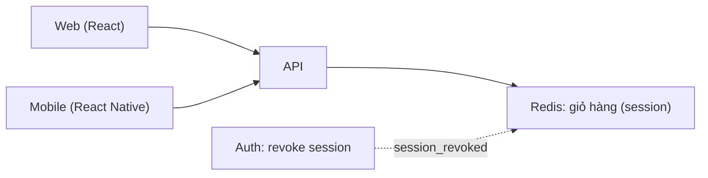
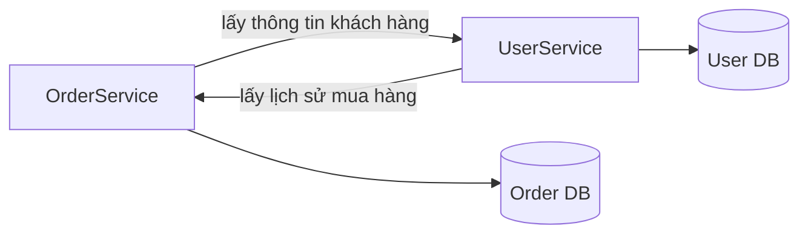
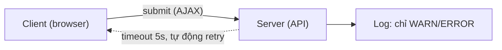
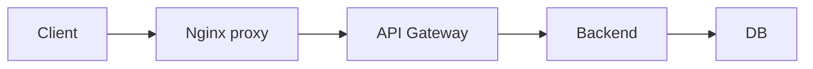
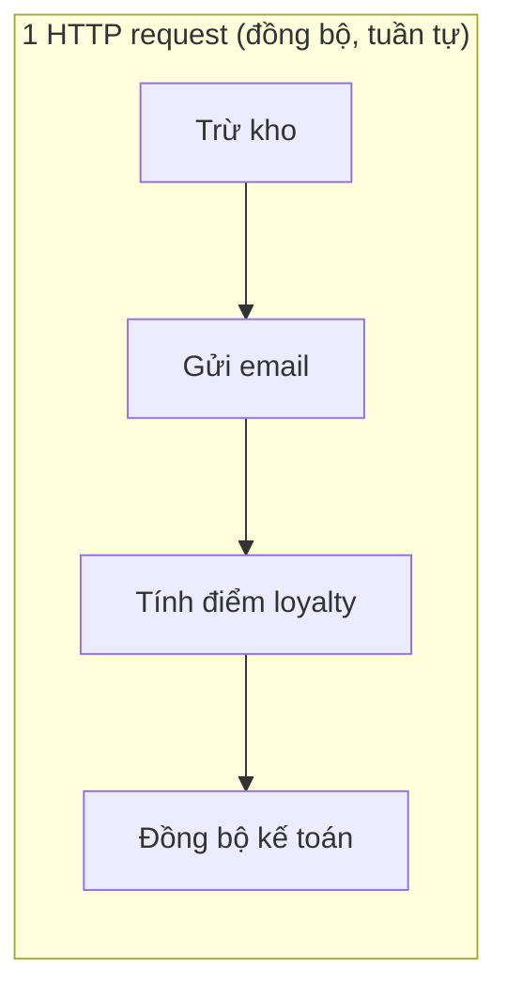
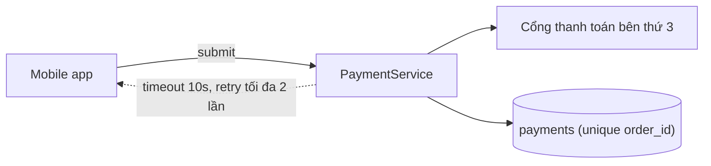
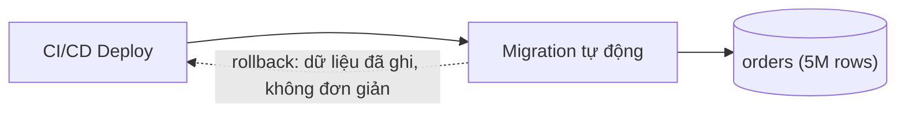
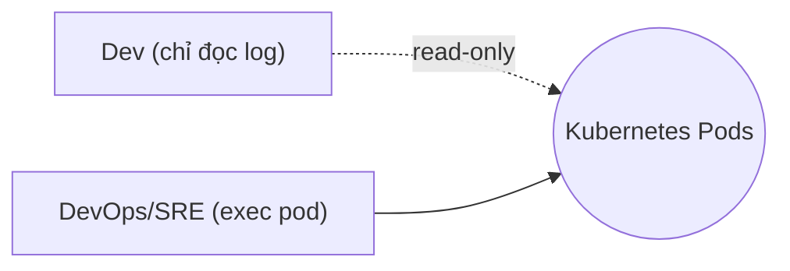

# Đề phỏng vấn DEV C#

## Câu 1

Web (React) và mobile app (React Native) đều gọi chung một Backend API. Giỏ hàng lưu trong Redis theo session token, chỉ ghi xuống DB chính khi checkout thành công. Service Auth xử lý đổi mật khẩu bằng cách revoke toàn bộ session cũ và phát event `session_revoked` qua message queue cho các service khác tự xử lý. Trong bối cảnh đó, bộ phận support nhận được 2 báo cáo lỗi riêng biệt từ 2 khách hàng khác nhau, cả hai đều mô tả cùng một hiện tượng: "giỏ hàng bị trống". User X gặp ngay sau khi thanh toán xong trên web; User Y gặp khi mở lại app trên mobile sau khi đổi mật khẩu. Hai user, hai thiết bị, hai thời điểm khác nhau — nhưng cùng một triệu chứng được báo cáo.

**Yêu cầu:**
- Giải thích vì sao 2 user X và Y đang gặp 2 vấn đề khác nhau?
- Nguyên nhân xảy ra lỗi là gì? Vì sao?
- Đề xuất giải pháp xử lý vấn đề này: sửa tận gốc nguyên nhân (không chỉ vá triệu chứng), và nêu hướng giảm rủi ro tái diễn cho các trường hợp tương tự sau này.

**Trả lời:**

...............................................

...............................................

...............................................

...............................................

...............................................

## Câu 2

OrderService và UserService đều là ASP.NET Core Web API (C#), mỗi service có DB riêng (Order DB, User DB), deploy độc lập nhưng dùng chung 1 CI/CD pipeline chạy deploy theo thứ tự cố định, chưa có event bus. OrderService cần gọi UserService qua REST đồng bộ để lấy thông tin khách hàng khi tạo đơn; UserService lại cần gọi ngược lại OrderService để hiển thị lịch sử mua hàng trên trang profile. Hai service đang gọi lẫn nhau.

**Yêu cầu:**
- Chỉ ra ít nhất 2 vấn đề có thể xảy ra.
- Đề xuất giải pháp giảm phụ thuộc giữa 2 service.
- Nêu rõ trade-off của phương án đề xuất.
- Giải thích vì sao vấn đề tương tự thường xuất hiện dần theo thời gian chứ không phải do thiết kế sai từ đầu.

**Trả lời:**

...............................................

...............................................

...............................................

...............................................

...............................................

## Câu 3

Form submit gọi API qua AJAX, validate ở cả client và server. Client có cơ chế tự động gửi lại request sau 5s nếu không nhận được response (timeout). Log hệ thống hiện chỉ ghi ở mức WARN/ERROR, không ghi log cho request xử lý thành công. Một user báo gặp lỗi "không thể submit form" 1 lần duy nhất, tuần trước. Bạn không tái hiện được lỗi từ đó đến nay, dù thử trên cùng browser, cùng tài khoản.

*Sơ đồ: log không đủ để bắt lỗi hiếm gặp*

**Yêu cầu cụ thể:**
- Nêu thứ tự các bước điều tra, bắt đầu từ đâu.
- Nêu thông tin cần hỏi thêm user/support trước khi kết luận "không tái hiện được nên bỏ qua".
- Nêu cách giảm xác suất gặp lại ngay cả khi chưa tìm ra nguyên nhân gốc.
- Quyết định khi nào nên dừng điều tra tiếp và ghi nhận lại để theo dõi, thay vì đào sâu vô thời hạn.

**Trả lời:**

...............................................

...............................................

...............................................

...............................................

...............................................

## Câu 4

Request đi qua: Client → Nginx reverse proxy → API Gateway → Backend service → DB. Mỗi lớp có log riêng, nhưng log các lớp chưa được gộp theo một request ID chung. Một request từ client bị lỗi 500. Lỗi có thể ở frontend, backend, hay network/infra — chưa biết ở đâu.

**Yêu cầu cụ thể:**
- Trình bày quy trình thu hẹp phạm vi nghi ngờ, từng bước.
- Mỗi bước nêu rõ đang kiểm chứng giả thuyết nào, và kết quả nào sẽ xác nhận/loại bỏ giả thuyết đó.
- Giải thích cách chọn thứ tự kiểm tra (tại sao kiểm tra A trước B).
- Nêu 1 ví dụ cụ thể từ kinh nghiệm đã dùng cách này.

**Trả lời:**

...............................................

...............................................

...............................................

...............................................

...............................................

## Câu 5

Khi user đặt hàng, hệ thống cần: (1) trừ kho, (2) gửi email xác nhận, (3) tính điểm tích lũy loyalty, (4) đồng bộ dữ liệu sang hệ thống kế toán. Hiện cả 4 bước này chạy đồng bộ trong cùng 1 request HTTP, gọi hàm nội bộ trong cùng service. Hệ thống đã có sẵn RabbitMQ dùng cho 1 use case khác (gửi SMS marketing), nên hạ tầng message queue không cần build mới.

**Yêu cầu cụ thể:**
- Phân loại từng bước nên xử lý đồng bộ (chặn request chính) hay bất đồng bộ (qua queue), và giải thích vì sao.
- Nêu tiêu chí chung để quyết định sync vs async cho một bước bất kỳ (không chỉ áp dụng cho ví dụ này).
- Nêu điều gì xảy ra nếu bước async bạn chọn bị lỗi/thất bại — user có biết không, hệ thống xử lý thế nào.
- Nêu trade-off về độ phức tạp vận hành khi thêm queue/async (không miễn phí).

**Trả lời:**

...............................................

...............................................

...............................................

...............................................

...............................................

## Câu 6

PaymentService gọi REST tới cổng thanh toán bên thứ 3; mobile app có timeout 10s và tự động retry tối đa 2 lần khi không nhận được response. Bảng `payments` hiện có unique constraint trên `order_id`. API `POST /payments/charge` có thể bị gọi lại nhiều lần do client retry khi mất kết nối mạng (client không biết request trước đã thành công hay chưa). Nếu không xử lý, khách hàng có thể bị trừ tiền 2 lần.

**Yêu cầu cụ thể:**
- Thiết kế cơ chế idempotency chống xử lý trùng.
- Nêu cách xử lý khi 2 request cùng idempotency key đến **gần như cùng lúc** (race condition).
- Nêu thời gian lưu idempotency key hợp lý và lý do.
- Nêu thêm 1 chỗ khác trong hệ thống cũng cần idempotency (ngoài thanh toán).

**Trả lời:**

...............................................

...............................................

...............................................

...............................................

...............................................

## Câu 7

Hệ thống dùng migration tool chạy tự động mỗi lần deploy. Bảng `orders` hiện có khoảng 5 triệu dòng, SLA cho phép downtime tối đa 5 phút mỗi lần deploy. Bạn chuẩn bị deploy một thay đổi lớn: đổi cấu trúc bảng `orders` để thêm cột mới bắt buộc, kèm migrate dữ liệu cũ.

**Yêu cầu cụ thể:**
- Nêu rollback plan cụ thể cho trường hợp này (không chung "rollback code lại").
- Chỉ ra vì sao rollback 1 migration DB khó hơn rollback code thường.
- Nêu điều kiện cụ thể để quyết định rollback thay vì hotfix.
- Nêu cần test rollback plan trước khi deploy thật không, và test ở đâu.

**Trả lời:**

...............................................

...............................................

...............................................

...............................................

...............................................

## Câu 8

Hạ tầng production chạy trên Kubernetes. Quyền truy cập chia theo role: Dev chỉ có quyền đọc log qua Grafana/Loki và xem dashboard, DevOps/SRE mới có quyền exec vào pod. Bạn cần chẩn đoán 1 lỗi trên production với quyền hiện có, bạn ko có quyền restart service (có thể ảnh hưởng user đang dùng).

**Yêu cầu cụ thể:**
- Nêu cách xác minh giả thuyết mà không cần can thiệp trực tiếp (vd: test lại trên môi trường staging giống production).
- Nêu khi nào cần escalate xin quyền cao hơn.
- Nêu cách giao tiếp với người có quyền (DevOps/SRE) để họ hỗ trợ hiệu quả (yêu cầu cụ thể gì, không chỉ "xem giúp").

**Trả lời:**

...............................................

...............................................

...............................................

...............................................

...............................................

