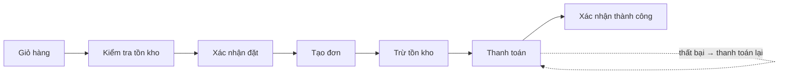
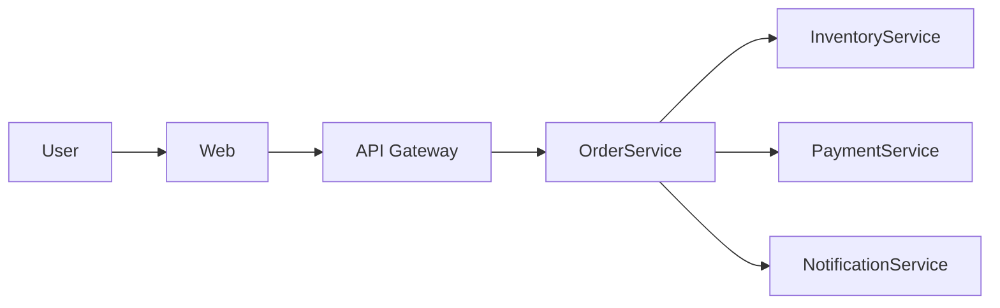
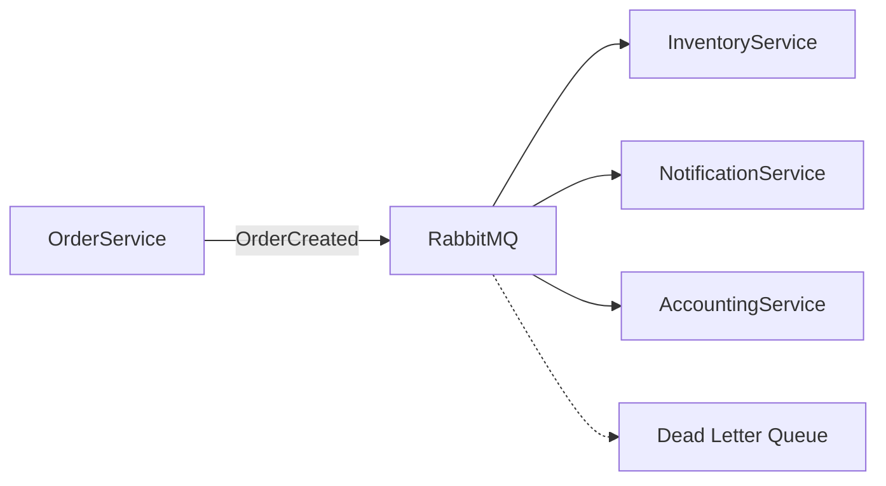
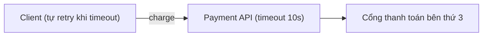
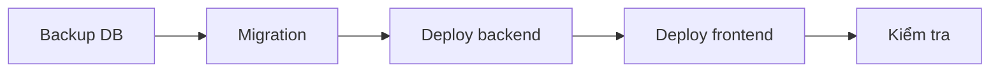
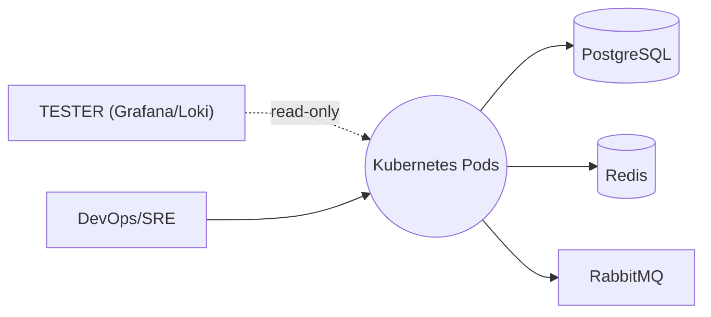

# Đề phỏng vấn TESTER Mid

## Câu 1

Một hệ thống thương mại điện tử có chức năng đặt hàng theo quy trình: (1) người dùng thêm sản phẩm vào giỏ hàng, (2) hệ thống kiểm tra tồn kho, (3) người dùng xác nhận đặt hàng, (4) hệ thống tạo đơn hàng, (5) hệ thống trừ tồn kho, (6) người dùng thanh toán, (7) hệ thống xác nhận đơn hàng thành công. Quy định nghiệp vụ: không cho đặt hàng nếu sản phẩm hết hàng; không cho thanh toán đơn hàng đã bị hủy; một đơn hàng chỉ được thanh toán thành công một lần; nếu thanh toán thất bại, người dùng có thể thực hiện lại.



**Yêu cầu cụ thể:**
- Đơn hàng có thể ở những trạng thái nào? Chuyển trạng thái nào được phép, chuyển nào không?
- Quy trình và quy định trên còn bỏ ngỏ những tình huống nào?
- Ở đâu trạng thái đơn hàng, thanh toán và tồn kho có thể lệch nhau? Mô tả cụ thể một tình huống.
- Em sẽ kiểm thử chức năng này theo những nhóm tình huống nào, nhóm nào trước, vì sao?
- BA đã xác nhận nghiệp vụ, DEV làm đúng tài liệu, nhưng vẫn phát sinh lỗi. Em xử lý thế nào?

**Trả lời:**

...............................................

...............................................

...............................................

...............................................

...............................................


## Câu 2

Một hệ thống bán hàng gồm: Web (giao diện), API Gateway (tiếp nhận request), OrderService (xử lý đơn hàng), PaymentService (thanh toán), InventoryService (tồn kho), NotificationService (gửi email/SMS). OrderService gọi tới 3 service còn lại. Gần đây ghi nhận 3 vấn đề: đơn hàng tạo thành công nhưng tồn kho không bị trừ; đơn hàng thanh toán thành công nhưng không gửi email; người dùng bấm đặt hàng nhiều lần và tạo ra nhiều đơn hàng.



**Yêu cầu cụ thể:**
- Với từng vấn đề được ghi nhận, lỗi có thể nằm ở đâu: bên trong một service, hay ở chỗ các service tương tác với nhau?
- Em kiểm thử luồng này ở những tầng nào? Mỗi tầng bắt được loại lỗi gì mà tầng khác không bắt được?
- Từng service đều vượt qua kiểm thử độc lập nhưng cả hệ thống vẫn lỗi — nguyên nhân có thể nằm ở đâu?
- Khi một service thay đổi, em xác định phạm vi kiểm thử hồi quy như thế nào?

**Trả lời:**

...............................................

...............................................

...............................................

...............................................

...............................................


## Câu 3

Dự án phát triển nền tảng hóa đơn điện tử với các chức năng: quản lý khách hàng, quản lý hóa đơn, phát hành hóa đơn, ký số, gửi hóa đơn cho cơ quan thuế, tra cứu hóa đơn, hủy và điều chỉnh hóa đơn. Hệ thống phục vụ 10.000 khách hàng doanh nghiệp, khoảng 30.000 hóa đơn/ngày, tích hợp nhiều nhà cung cấp ký số và hệ thống thuế bên ngoài; nhiều chức năng dùng chung dữ liệu. Thời gian kiểm thử trước khi release chỉ có 5 ngày.

**Yêu cầu cụ thể:**
- Em tổ chức 5 ngày kiểm thử như thế nào? Ngày đầu tiên em làm gì?
- Chức năng nào cần ưu tiên kiểm thử trước? Em dựa vào tiêu chí gì để xếp ưu tiên?
- Những loại kiểm thử nào cần có cho hệ thống này? Loại nào có thể cắt giảm nếu thiếu thời gian, loại nào không được cắt?
- Điều kiện nào để em đồng ý cho release? Điều kiện nào khiến em phản đối release?
- Nếu không đủ thời gian kiểm thử hết, em quyết định thế nào, báo cáo với ai và nói gì?

**Trả lời:**

...............................................

...............................................

...............................................

...............................................

...............................................


## Câu 4

Một khách hàng báo: "Thỉnh thoảng khi phát hành hóa đơn, hệ thống thông báo thành công nhưng khi tra cứu lại không thấy hóa đơn." Lỗi xuất hiện khoảng 1–2 lần/tuần; DEV thử nhiều lần nhưng không tái hiện được. Hệ thống có nhiều service, dùng RabbitMQ xử lý bất đồng bộ. Log hiện chưa có ID thống nhất để nối một request qua các service, và chưa lưu đầy đủ lịch sử chuyển trạng thái của hóa đơn.

**Yêu cầu cụ thể:**
- Trình bày quy trình điều tra lỗi theo từng bước, bắt đầu từ đâu.
- Cần thu thập những thông tin gì từ khách hàng và từ hệ thống?
- Những giả thuyết nào có thể dẫn tới hiện tượng này? Với mỗi giả thuyết, em kiểm chứng thế nào, kết quả nào xác nhận hoặc loại bỏ nó?
- Nếu không tái hiện được, em có được kết luận lỗi không tồn tại không? Vì sao?
- Cần thay đổi gì để lần sau phát hiện và truy vết lỗi tương tự nhanh hơn?

**Trả lời:**

...............................................

...............................................

...............................................

...............................................

...............................................


## Câu 5

Hệ thống xử lý đơn hàng dùng RabbitMQ. Khi khách đặt hàng: OrderService tạo đơn rồi publish event `OrderCreated`; InventoryService nhận event để trừ tồn kho; NotificationService nhận event để gửi email; AccountingService nhận event để đồng bộ dữ liệu kế toán. Trong vận hành thực tế: một event có thể được gửi nhiều lần, consumer có thể bị dừng giữa chừng khi đang xử lý, message có thể bị xử lý chậm, một số message bị đưa vào Dead Letter Queue.



**Yêu cầu cụ thể:**
- Những tình huống nào có thể làm quy trình này cho kết quả sai? Em kiểm thử chúng thế nào?
- Làm sao phát hiện một event bị xử lý nhiều lần? Dấu hiệu nào cho thấy hệ thống xử lý đúng?
- Consumer bị dừng giữa chừng khi đang xử lý — em tạo tình huống này để kiểm thử thế nào, và kỳ vọng điều gì?
- NotificationService lỗi nhưng InventoryService thành công — đơn hàng này có được coi là thành công không? Vì sao?
- Khi message rơi vào Dead Letter Queue, sau đó chuyện gì cần xảy ra, và em kiểm chứng điều đó thế nào?

**Trả lời:**

...............................................

...............................................

...............................................

...............................................

...............................................


## Câu 6

API thanh toán `POST /api/payments/charge` nhận request:

```json
{
  "orderId": "ORD001",
  "amount": 1000000,
  "paymentMethod": "CARD"
}
```

Quy định: một đơn hàng chỉ được thanh toán một lần; client tự động retry khi timeout; API có thể nhận nhiều request đồng thời; cổng thanh toán là hệ thống bên thứ ba; timeout của API là 10 giây.



**Yêu cầu cụ thể:**
- Em sẽ thử API này với những đầu vào nào? Vì sao chọn những giá trị đó?
- Hai request thanh toán cùng một đơn hàng đến gần như cùng lúc — em tạo và kiểm chứng tình huống này thế nào?
- Cổng thanh toán đã trừ tiền nhưng API không nhận được phản hồi — em kiểm thử tình huống này thế nào, kỳ vọng hệ thống làm gì?
- Dựa vào đâu để khẳng định hệ thống không thu tiền trùng?
- Em kiểm thử hiệu năng và tải cho API này thế nào? Đo những chỉ số gì, ngưỡng nào là đạt?

**Trả lời:**

...............................................

...............................................

...............................................

...............................................

...............................................


## Câu 7

Hệ thống đang chạy production. Phiên bản mới gồm: thêm trường bắt buộc vào bảng `orders`; đổi API từ V1 sang V2 với cấu trúc dữ liệu trả về thay đổi; thêm một chức năng mới liên quan đến thanh toán; có migration chuyển đổi dữ liệu cũ. Quy trình deploy: (1) backup database, (2) chạy migration, (3) deploy backend, (4) deploy frontend, (5) kiểm tra hệ thống. SLA cho phép downtime tối đa 5 phút.



**Yêu cầu cụ thể:**
- Em kiểm thử những gì trước khi deploy, và những gì sau khi deploy?
- Chức năng nào cần kiểm thử hồi quy? Vì sao chọn những chức năng đó?
- Client đang dùng API V1 có bị ảnh hưởng không? Em kiểm chứng thế nào?
- Làm sao phát hiện dữ liệu cũ bị sai lệch sau migration?
- Ngay sau deploy, em kiểm tra những gì trong vài phút đầu, theo thứ tự nào?
- Phát hiện lỗi nghiêm trọng sau deploy — em phối hợp với DEV và DevOps thế nào? Khi nào em đề xuất rollback, khi nào đề xuất hotfix?

**Trả lời:**

...............................................

...............................................

...............................................

...............................................

...............................................


## Câu 8

Production chạy trên Kubernetes, gồm API Gateway, Backend API, PostgreSQL, Redis, RabbitMQ; mỗi service có log riêng. Phân quyền: TESTER chỉ xem log và dashboard qua Grafana/Loki; DEV chỉ đọc log và xem dashboard; DevOps/SRE mới có quyền truy cập Kubernetes. TESTER không được restart service hay can thiệp trực tiếp vào production. Một khách hàng báo: "Thỉnh thoảng thao tác lưu dữ liệu quay rất lâu rồi báo lỗi. Thực hiện lại thì thành công."



**Yêu cầu cụ thể:**
- Trình bày quy trình điều tra lỗi với quyền hạn hiện có.
- Những giả thuyết nào cần kiểm chứng? Làm sao khoanh vùng lỗi nằm ở API, DB, Redis, RabbitMQ hay hạ tầng?
- Cần cung cấp gì cho DevOps/SRE để họ hỗ trợ hiệu quả (cụ thể, không chỉ "xem giúp")? Khi nào cần escalate?
- Sau khi DEV sửa và deploy lên production, TESTER còn trách nhiệm gì?

**Trả lời:**

...............................................

...............................................

...............................................

...............................................

...............................................
