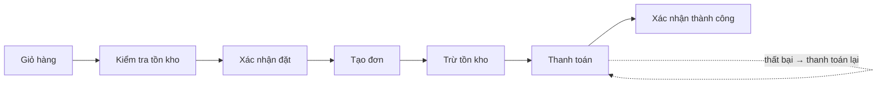
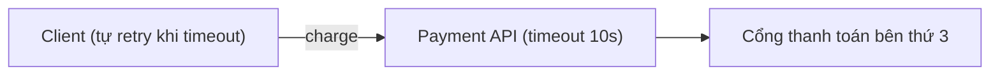
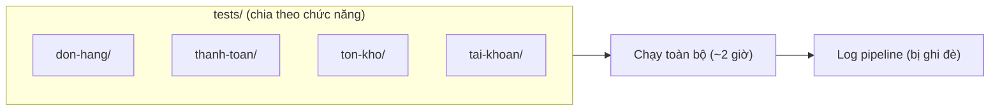

# Đề phỏng vấn TESTER Mid — Automation

## Câu 1

Một hệ thống thương mại điện tử có chức năng đặt hàng theo quy trình: (1) người dùng thêm sản phẩm vào giỏ hàng, (2) hệ thống kiểm tra tồn kho, (3) người dùng xác nhận đặt hàng, (4) hệ thống tạo đơn hàng, (5) hệ thống trừ tồn kho, (6) người dùng thanh toán, (7) hệ thống xác nhận đơn hàng thành công. Quy định nghiệp vụ: không cho đặt hàng nếu sản phẩm hết hàng; không cho thanh toán đơn hàng đã bị hủy; một đơn hàng chỉ được thanh toán thành công một lần; nếu thanh toán thất bại, người dùng có thể thực hiện lại.



**Yêu cầu cụ thể:**
- Đơn hàng có thể ở những trạng thái nào? Chuyển trạng thái nào được phép, chuyển nào không?
- Quy trình và quy định trên còn bỏ ngỏ những tình huống nào?
- Ở đâu trạng thái đơn hàng, thanh toán và tồn kho có thể lệch nhau? Mô tả cụ thể một tình huống.
- Em sẽ kiểm thử chức năng này theo những nhóm tình huống nào, nhóm nào trước, vì sao?
- BA đã xác nhận nghiệp vụ, DEV làm đúng tài liệu, nhưng vẫn phát sinh lỗi. Em xử lý thế nào?

**Trả lời:**

............................................................................................................................................................................................

............................................................................................................................................................................................

............................................................................................................................................................................................

............................................................................................................................................................................................

............................................................................................................................................................................................


## Câu 2

API thanh toán `POST /api/payments/charge` nhận request:

```json
{
  "orderId": "ORD001",
  "amount": 1000000,
  "paymentMethod": "CARD"
}
```

Quy định: một đơn hàng chỉ được thanh toán một lần; client tự động retry khi timeout; API có thể nhận nhiều request đồng thời; cổng thanh toán là hệ thống bên thứ ba; timeout của API là 10 giây.



**Yêu cầu cụ thể:**
- Em sẽ thử API này với những đầu vào nào? Vì sao chọn những giá trị đó?
- Hai request thanh toán cùng một đơn hàng đến gần như cùng lúc — em tạo và kiểm chứng tình huống này thế nào?
- Cổng thanh toán đã trừ tiền nhưng API không nhận được phản hồi — em kiểm thử tình huống này thế nào, kỳ vọng hệ thống làm gì?
- Dựa vào đâu để khẳng định hệ thống không thu tiền trùng?
- Em kiểm thử hiệu năng và tải cho API này thế nào? Đo những chỉ số gì, ngưỡng nào là đạt?

**Trả lời:**

............................................................................................................................................................................................

............................................................................................................................................................................................

............................................................................................................................................................................................

............................................................................................................................................................................................

............................................................................................................................................................................................


## Câu 3

Team đang có một dự án automation test cho chính hệ thống ở câu 1 và câu 2 (khoảng 600 test case, gồm cả API và UI). Toàn bộ test case nằm trong một thư mục chung, chia thư mục con theo chức năng: `don-hang/`, `thanh-toan/`, `ton-kho/`, `tai-khoan/`. Mỗi lần chạy đều chạy toàn bộ, mất khoảng 2 giờ, kể cả khi chỉ cần kiểm tra nhanh sau deploy. Kết quả chỉ in ra log của pipeline và bị ghi đè ở lần chạy sau, nên không ai trả lời được: test này bắt đầu lỗi từ bản build nào, test nào lúc đạt lúc không, thời gian chạy đang tăng hay giảm.



Team giao em thiết kế lại cấu trúc dự án, với ba mục tiêu:
- Phân loại được test case là functional, regression, smoke — một test case có thể thuộc nhiều loại — nhưng mỗi test case vẫn chỉ tồn tại **một bản duy nhất**, không được lặp lại.
- Mỗi lần chạy, người chạy **chọn được phạm vi và cách chạy**. Ví dụ: sau deploy chỉ chạy kiểm tra nhanh các luồng chính trong vài phút; trước release chạy hồi quy riêng module Thanh toán trên môi trường staging.
- Kết quả **mỗi lần chạy đều được lưu lại** để so sánh và thống kê giữa các lần.

**Yêu cầu cụ thể:**
- Vẽ cây thư mục dự án em đề xuất và giải thích từng phần chứa gì.
- Em tổ chức và phân loại test case thế nào để không phải lặp lại test case? Khi thêm một test case mới, người viết cần làm gì để nó được chạy đúng nhóm?
- Người chạy chọn phạm vi và cách chạy bằng cách nào? Những gì nên chọn được khi chạy, những gì nên cố định trong dự án?
- Mỗi lần chạy em lưu lại những thông tin gì, lưu ở đâu? Từ dữ liệu đó em thống kê được những gì, và nó giúp team quyết định điều gì?
- Em phân loại 600 test case hiện có và chuyển sang cấu trúc mới thế nào mà không làm gián đoạn việc kiểm thử đang chạy hằng ngày?

**Trả lời:**

............................................................................................................................................................................................

............................................................................................................................................................................................

............................................................................................................................................................................................

............................................................................................................................................................................................

............................................................................................................................................................................................
